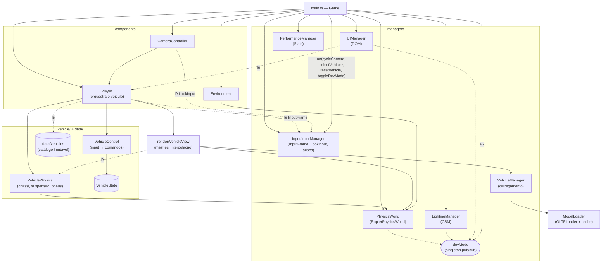
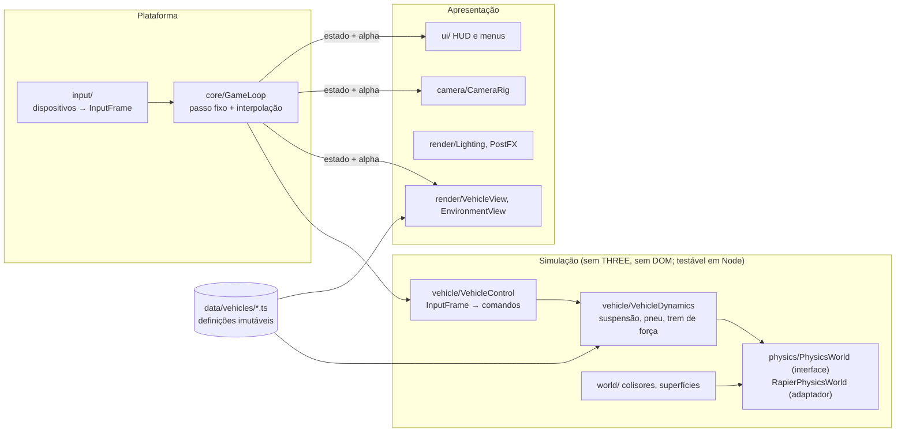

# Arquitetura

Este documento descreve a arquitetura **como ela está no código** e, separadamente, a arquitetura para onde ela deve evoluir. Cada afirmação usa uma das três marcações:

- **[Implementado]** — verificado no código da `master` (e, quando dito, na `refact/rapier3d`).
- **[Planejado]** — evolução recomendada, ainda inexistente.
- **[Investigar]** — questão em aberto que exige análise antes de decidir.

Referência de base: branch `stabilize/rapier` (Rapier, ROADMAP P0-5). A implementação anterior com cannon-es e a `refact/rapier3d` são comparadas no [ADR-0001](docs/decisions/ADR-0001-motor-de-fisica.md).

---

## 1. Visão geral [Implementado]

Aplicação de navegador, sem servidor. Um único bundle Vite carrega `src/main.ts`, que instancia a classe `Game`. `Game` cria todos os subsistemas no construtor, guarda cada um em um campo público e roda um loop com `requestAnimationFrame`.

Não há ECS, injeção de dependência, barramento de eventos nem estado serializável. Os subsistemas recebem referências diretas uns dos outros pelo construtor. Mecanismos de publicação/assinatura: `DevModeManager` (singleton `devMode`) e as ações discretas do `InputManager` (`on(action, handler)`, assinadas em `main.ts`).

Tamanho: ~3,2 mil linhas de TypeScript em 24 arquivos de jogo. Testes: Vitest em Node (`test/`), com cenários de referência do veículo (§3.8).

## 2. Ciclo de execução [Implementado]

`Game.gameLoop` (`src/main.ts`), por quadro:

1. `deltaTime` = tempo real desde o último quadro, limitado a 0,1 s.
2. `inputManager.update()` lê teclado, mouse e gamepad e reescreve o `InputFrame` e o `LookInput` do quadro; botões do gamepad emitem ações discretas aqui (teclas, no `keydown`).
3. `physicsManager.update(dt)` → acumulador com passo fixo de 1/60 s. A cada passo: guarda a pose anterior das entidades, roda os *pre-step callbacks* (no `Player`: `VehicleControl.step` lê o `InputFrame` do quadro, integra o volante e gera motor/freio, `VehiclePhysics` guarda os comandos e calcula suspensão e pneus das quatro rodas, aplicando os impulsos no chassi) e `world.step()`. Depois, `alpha = acumulador / passo` e os meshes registrados recebem a pose interpolada entre os dois últimos passos; atualiza o debug renderer (sem interpolação).
4. `update(dt)` em `[environment, lightingManager, player, cameraController, performanceManager]`:
   - `Player.update` → `VehicleView.update`: só visual — chassi e rodas (suspensão, esterço, giro) interpolados pelo mesmo `alpha`.
   - `CameraController.update`: posiciona a câmera conforme o modo, a partir da pose interpolada do mesh do chassi.
   - `LightingManager.update`: `csm.update()`.
5. `audio.update(dt)` (`VehicleAudio`) e `ui.updatePlayerInfo` (só no modo dev).
6. `renderer.render(scene, camera)`.

Consequências:

- Input entra no primeiro passo do quadro (sem quadro de latência); o mesmo roteiro dá a mesma sequência de passos a 30, 60 e 144 FPS (teste em `vehicle-reference.test.ts`).
- O visual fica até 1 passo (16,7 ms) atrás da física, em troca de movimento uniforme a qualquer taxa de quadros.
- A ordem ainda está espalhada entre `Game.gameLoop`, `RapierPhysicsWorld.update` e a ordem de `components`; não há módulo `GameLoop` dedicado.

Inicialização assíncrona: `Game.initialize()` aguarda `RapierPhysicsWorld.create()` (`RAPIER.init()`, WASM).

## 3. Subsistemas

### 3.1 Física — `src/physics/` [Implementado]

- Contrato `PhysicsWorld` (`physics/PhysicsWorld.ts`): `PhysicsBody` (pose, velocidades, leituras em `out`, impulso no centro de massa e em ponto, velocidade em ponto), criação/remoção de corpos e colisores (caixa com centro de massa deslocado, `ColliderConfig.centerOfMass`), pré-passo, `update` em passo fixo, interpolação, `castRay` (distância ou null), `castRayWithNormal` (distância, ponto, normal e corpo atingido, com corpo excluído, em `out`; vê os colisores do fim do último passo), eventos de força de contato (`ColliderConfig.contactForceThreshold` em N; `contactEventCount`/`getContactEvent` com corpos, impulso em N·s e ponto médio, de todos os passos do último `update`, até 64, buffer pré-alocado), `countObjects`. SI e eixos do ADR-0002 documentados nos tipos.
- Adaptador `RapierPhysicsWorld` (+ `RapierBody`, `PhysicsDebugRenderer`): único lugar que importa `@dimforge/rapier3d-compat`. `main.ts` e os testes criam o adaptador; `VehiclePhysics`, `Environment`, `VehicleView`, `Player` e o harness só conhecem a interface.

- `RAPIER.World` (`@dimforge/rapier3d-compat` 0.19.3, WASM embutido no bundle), gravidade −9,82, criado por `RapierPhysicsWorld.create()` (assíncrono).
- Passo fixo por acumulador (`world.timestep` igual), 1/60 s por padrão, configurável em `RapierPhysicsWorld.create(scene, fixedTimeStep)`; *pre-step callbacks* para lógica que precisa rodar a cada passo.
- Interpolação: pose anterior/atual por entidade (`addEntity`), `getInterpolationAlpha()`, `getInterpolatedPose()`; `resetInterpolation()` após teleporte.
- Passo mantido em 1/60 s (avaliado 1/120 e 1/240 s): frenagem, aceleração e aceleração lateral mudam < 1%; a curva do G63 troca velocidade por guinada (~3% por halving do passo, sem convergir até 1/240 s) e o repouso baixa 3–4 mm. Custo da física desprezível nos dois casos (~6 vs ~9 µs por quadro em Node). Reavaliar no P2-1.
- Criação tipada: `createRigidBody(RigidBodyConfig)`, `createCollider(ColliderConfig)`, `createGroundCollider`; `castRay`/`castRayWithNormal` (o adaptador mantém um mapa handle → corpo para devolver o corpo atingido); `PhysicsBody.applyImpulse` (impulso no centro de massa, N·s), `applyImpulseAtPoint`, `getVelocityAtPoint`.
- Lista `entities` (corpo + alvo `PoseTarget`) para sincronização visual; `removeRigidBody` remove o corpo (e colisores) do mundo e do registro.
- `PhysicsDebugRenderer`: arestas de cada colisor criadas uma vez no espaço do corpo e posicionadas por quadro na pose interpolada, como as meshes (P2-9). Ligado pelo próprio adaptador via `devMode`; não faz parte da interface.
- Atenção: `RigidBody.linvel()` do chassi apoiado não é zero em repouso: a Rapier integra em 4 subpassos e a velocidade ao fim do passo difere da média em g·dt·3/8 (0,061 m/s a 60 Hz); meça movimento por deslocamento (a suspensão usa a variação de comprimento).

Unidades e eixos ([ADR-0002](docs/decisions/ADR-0002-unidades-e-eixos.md)): **SI**, 1 unidade = 1 m; mundo com +Y para cima. Modelos em escala 1, chassi 4,6 × 1,2 × 1,8 m, massas 1.550 kg (BMW) e 2.500 kg (G63); o HUD mostra km/h reais. A plataforma de 200 m do `Environment` é pequena para essas velocidades (o harness usa um chão de 1 km).

### 3.2 Veículo — `src/components/Player.ts`, `src/vehicle/`, `src/render/VehicleView.ts`, `src/data/vehicles/` [Implementado]

- `data/vehicles` (`types.ts`, um arquivo por veículo, `index.ts`): contrato `VehicleDefinition` e catálogo (`bmw_f82`, `mercedes_g63`) congelado; modelo, escala, física, câmeras, condução e rodas.
- `vehicle/VehicleState`: estado de runtime por instância (esterço, velocidade à frente, multiplicador de boost, cópia da rotação do motor, marcha (0 = ponto morto), troca em curso). A rotação do motor é estado do `Driveline`.
- `vehicle/VehicleControl`: `InputFrame` → `VehicleCommands` a cada passo — rampa e retorno do volante (reduzidos com a velocidade), trem de força, freio, ré quando quase parado, freio de mão, boost, resistência ao rolamento sem acelerador nem freio. Sem THREE nem DOM; testes unitários em `test/vehicle/`.
- `vehicle/Powertrain` (ADR-0003, etapas 1 e 4): central do motor e do câmbio, no controle. Câmbio automático com histerese pela velocidade do veículo, ré, ponto morto, limitador de velocidade, boost. Comanda o trem de força (`DrivelineCommands`: acelerador, multiplicador, relação total, capacidade da embreagem, acoplamento do conversor): embreagem progressiva pela rotação da entrada do câmbio (e do motor na arrancada), reacoplamento e aceleração do motor até a rotação nova na troca. Dados em `VehicleDefinition.powertrain`.
- `vehicle/Driveline` (ADR-0003, etapa 4): dono da rotação do motor. Motor (`vehicle/Engine`: curva, freio-motor, controle de lenta, corte) com inércia, embreagem de Coulomb e conversor (`vehicle/TorqueConverter`), câmbio e árvore de diferenciais com repartição e bloqueio (pré-carga, por torque, viscoso). Resolve o motor e as rodas motrizes juntos no passo, implícito, sem subpassos.
- `vehicle/aerodynamics`: arrasto 0,5·ρ·Cd·A·v² (`VehicleDefinition.aerodynamics`), aplicado por `VehiclePhysics` como impulso no chassi a cada passo.
- `vehicle/Suspension` (ADR-0003, etapa 2): forças por roda a partir da medição — mola (N/m), amortecedor de compressão/extensão (N·s/m), batente progressivo no fim de curso, barra estabilizadora por eixo (N/m de diferença de compressão). Dados em `VehicleDefinition.suspension`. Sem THREE nem motor; testes unitários e analíticos.
- `vehicle/Tire` (ADR-0003, etapa 3): escorregamento longitudinal (ω·r − vx)/max(|vx|, vMín) e ângulo de deriva atan(vy/max(|vx|, vMín)); curva de Pacejka simplificada (B, C, μ, E) por direção; atrito combinado por escorregamento normalizado, dentro da elipse (μx·Fz, μy·Fz); força proporcional à carga. Dados em `VehicleDefinition.tire`. Sem estado.
- `vehicle/WheelDynamics` (etapa 3): velocidade angular da roda (rad/s) com inércia da roda; o motor entra pelo `Driveline`. Euler implícito: a força de cada direção é a do escorregamento no fim do passo, raiz de uma equação monótona achada por falsa posição (Illinois), sem subpassos. Freio de Coulomb (trava ou se opõe ao giro, nunca inverte); elipse de atrito no fim. `prepare`/`solve`/`commit` com dω/dT para o trem de força.
- `vehicle/VehiclePhysics`: dono do chassi (corpo dinâmico + cuboid com centro de massa em `physics.centerOfMass`), da `Suspension`, do `Tire` e do estado das rodas. No pré-passo mede cada roda com `castRayWithNormal` (ignorando o chassi), calcula a suspensão, a velocidade do contato nos eixos da roda (frente esterçada e direita no plano de contato) e as forças do pneu; só depois aplica os impulsos das quatro rodas (suspensão ao longo da normal no ponto de fixação, pneu no ponto de contato), para nenhuma roda ver o impulso de outra. A massa do contato é a fração, pela carga, da massa efetiva do chassi para um impulso no chão (com rolagem e arfagem). Rodas motrizes resolvidas pelo `Driveline`, freio por eixo em N·m, freio de mão nas traseiras, arrasto. Ao escrever o estado do chassi, as rodas passam a rolar na velocidade do chassi e o motor gira na rotação da marcha do estado escrito (replay determinístico). Usa THREE só para matemática.
- `render/VehicleView`: placeholders, carregamento do modelo via `VehicleManager` (ignora carregamentos obsoletos com `loadRequestId`), pose interpolada do chassi e das rodas com os ajustes de alinhamento, liberação via `VehicleManager.releaseObjects`. Na troca, as meshes antigas saem da cena e só são devolvidas depois de o novo carregamento reservar seus modelos, para a roda comum aos dois veículos não sair da GPU.
- `Player`: orquestra as peças — registra o pré-passo (telemetria → input ou replay → `VehicleControl` → `VehiclePhysics`), troca de veículo, *reset*, gravação/reprodução de replay e consultas para câmera e UI (`mesh`, `getPosition`, `getQuaternion`, `getRotation`, `getCameraConfig`, `getCurrentSpeed`, `getWheelAngle`, `getTelemetry`).
- `vehicle/VehicleTelemetry`: reescrita no lugar no início de cada pré-passo (resultado do passo anterior, sem alocação): velocidade, aceleração longitudinal/lateral em g (diferença de velocidade no passo, eixos do chassi), esterço e, por roda, contato, comprimento e compressão da suspensão (m), força da suspensão (N), impulsos (N·s) e forças (N) longitudinal e lateral do pneu, escorregamento, deriva (rad) e velocidade angular da roda (rad/s). O HUD de dev mostra força, escorregamento (%) e deriva (°) por roda. Inclui rpm (do `Driveline`), marcha, escorregamento da embreagem (rpm), embreagem travada, carga do motor (acelerador efetivo: fração do torque a plena carga, com lenta e corte), corte de giro ativo, torque do trem de força por roda (N·m) e escorregamento combinado normalizado ao pico por roda (1 no pico de aderência). Em repouso a soma das forças de suspensão é m·g (teste).
- `VehicleManager`: carrega os glTF, com *fallback* para primitivas, e devolve objetos fora da cena; `releaseObjects` libera os recursos próprios (inclusive texturas) e devolve as instâncias ao cache.
- `loaders/ModelLoader`: cache por caminho, dono do modelo-base e de suas geometrias, materiais e texturas; um download por caminho mesmo com pedidos simultâneos. Cada `loadModel` é uma instância (clone) a devolver com `releaseModel`; sem instâncias, os recursos são liberados na GPU e o modelo fica em memória para reutilização sem novo download (`clearCache` descarta os não usados). `isCached` diz o que não pode ser liberado por quem usa a instância.
- `render/disposeObjects`: coleta geometrias, materiais e texturas (propriedades do material e uniforms) e libera, exceto os compartilhados.

Limitações:

- Eixos locais do chassi: frente +X, cima +Y, direita +Z (`VehiclePhysics.LOCAL_FORWARD` etc.); ângulo de esterço positivo vira à esquerda.
- Índices de roda fixos (0/1 dianteiras esquerda/direita, 2/3 traseiras; ímpares espelhadas) sem tipo que os represente.
- Recursos GPU: trocar de veículo 20 vezes mantém `renderer.info.memory` constante (P1-5, medido no navegador: BMW 392 geometrias/31 texturas, G63 608/40). Modelos-base ficam em memória de CPU pelo resto da sessão (dois veículos hoje).
- O mesh de *placeholder* continua registrado no `PhysicsWorld` depois que o modelo real é carregado.
- O `Player` recebe só o `InputFrame` (P1-4).

Modelo físico do veículo: todo próprio sobre o corpo rígido (ADR-0003): trem de força e arrasto (etapa 1), suspensão (etapa 2), pneu, roda com inércia e freio por torque (etapa 3), motor com rotação própria, embreagem/conversor, diferenciais com bloqueio e freio-motor (etapa 4) **[Implementado]**. O controlador *raycast* da Rapier não é mais usado nem faz parte do contrato. Sem controle de tração nem ESC (P2-2) **[Planejado]**. Sem massa não suspensa, sem sensibilidade do pneu à carga, sem Ackermann; a reação da suspensão e do pneu não vai ao corpo atingido.

### 3.2.1 Replay — `src/replay/` [Implementado]

- `Replay`: estado inicial (`vehicleId`, pose e velocidades linear/angular do chassi, esterço, marcha e troca em curso) + um `InputFrame` por passo de física em arrays tipados (`Float64Array`: valores analógicos exatos; bits para freio de mão/boost) e o passo fixo.
- `ReplayRecorder` grava em buffers pré-alocados (padrão 10 min a 60 Hz; para ao encher); `ReplayPlayback` escreve o passo seguinte num `InputFrame` próprio. `Player.startRecording/stopRecording/playReplay`; o pré-passo usa o frame do replay no lugar do `InputFrame` ao vivo e grava o frame efetivamente usado.
- Determinismo: o passo é fixo e o input é por passo, logo a reprodução independe da taxa de quadros. Ao iniciar a gravação o estado capturado é reaplicado ao chassi, porque a Rapier normaliza o quaternion em `setRotation` (diferença de 1 ulp); assim gravação e reprodução partem do mesmo estado. Reproduz bit a bit em mundo novo (`test/replay/`) desde que o mundo seja o mesmo; no jogo os corpos dinâmicos do `Environment` não são restaurados.
- *Reset* ou troca de veículo descartam gravação e reprodução; passo fixo diferente do gravado lança erro.
- Pasta própria em vez de `src/debug/`: o replay é dado de simulação (regressão, futuros *ghosts*), não ferramenta de depuração visual. Botões gravar/reproduzir no HUD de dev.

### 3.3 Input — `src/input/` [Implementado]

- `InputFrame.ts` (contrato): `InputFrame` — `throttle`, `brake` (0–1), `steer` (−1…+1, positivo à direita), `handbrake`, `boost` — e `LookInput` (delta do mouse em px, pointer lock, taxa do analógico em rad/s, passos de zoom da roda, segundos desde o último movimento). Dono: `InputManager`, que reescreve os dois objetos no lugar uma vez por quadro em `update()`, antes da física; consumidores recebem `Readonly<…>` no construtor (`Player` → `VehicleControl`; `CameraController`). Todos os passos de física do quadro leem o mesmo `InputFrame`.
- `InputBindings.ts`: mapeamento como dados (`DEFAULT_INPUT_BINDINGS`): teclas por controle contínuo e por ação, botões do gamepad, eixo do volante, gatilhos e *deadzone*. O `InputManager` aceita outro objeto no construtor.
- Gamepad: analógico com *deadzone* reescalada, gatilhos com limiar; teclado (digital, 1) sobrescreve o gamepad; esquerda + direita no teclado = direita.
- Ações discretas (`InputAction`: `toggleDevMode`, `cycleCamera`, `resetCamera`, `selectVehicle1/2`, `resetVehicle`) são eventos tipados: `inputManager.on(action, handler)`, assinados em `Game.bindInputActions` (`main.ts`) por quem é dono de cada uma. Tecla: no `keydown`, sem repetição automática; botão do gamepad: borda de subida, durante `update()`. `src/input` não importa `Game`, `Player`, `CameraController` nem `devMode` (teste em `test/input/`).
- Sem alocação por quadro além de `navigator.getGamepads()`.
### 3.4 Câmera — `src/components/CameraController.ts`, `src/camera/` [Implementado]

- Três modos por veículo (`cameraSettings`): `FIRST_PERSON` (padrão) e `HOOD` presos ao chassi; `THIRD_PERSON` de perseguição. Olhar livre pelo mouse (pointer lock) e pelo analógico direito nos três modos; auto-centro ao soltar só nas câmeras presas (a órbita fica onde o jogador deixou). Zoom pela roda do mouse em todos os modos, guardado por modo (distância e altura × 0,6–2,5 na perseguição; FOV × 0,5–1,3 nas presas); clique da roda (ou R3) emite `resetCamera`: olhar ao centro e zoom 1 no modo ativo.
- `camera/ChaseCamera` (sem cena nem DOM): órbita rígida em volta do pivô (distância, altura e FOV fixos, o carro fica no centro) atrás da frente do chassi, desviada para fora da curva por guinada × 0,25 s (máx. 0,3 rad) acima de 1–5 m/s de avanço, então a lateral de fora aparece; parado e em ré, sem desvio. Só o rumo tem mola crítica (τ 0,15 s, forma fechada, independente do FPS) com a guinada como antecipação de taxa: sem atraso em curva constante. Colisão por raio do ponto de mira até a câmera (`PhysicsWorld.castRayWithNormal`, excluindo o chassi), com aproximação imediata e afastamento suave. Testes em `test/camera/`.
- Analógico: `LookInput.yawRate/pitchRate` em rad/s (zona morta radial 0,15, curva quadrática, 3 rad/s no fim de curso); só de controles com `mapping === "standard"`, então o G29 não move a câmera.

### 3.5 Renderização e iluminação — `src/main.ts`, `src/managers/LightingManager.ts`, `src/components/Environment.ts` [Implementado]

- `WebGLRenderer` (WebGL2, ADR-0006), `shadowMap.type = VSMShadowMap`, `pixelRatio = min(devicePixelRatio, 2)`. Com pós-processamento (padrão), canvas sem MSAA e `render/PostProcessing` faz cena em HalfFloat → bloom (MSAA 4× no alvo) → `OutputPass` (tone mapping) → SMAA/FXAA opcionais; `?post=0` renderiza direto com MSAA; `?quality=baixa|media|alta`.
- Pipeline de cor (`RENDER_CONFIG` em `main.ts`): `outputColorSpace = SRGBColorSpace`, *tone mapping* AgX, exposição 1,3 (sobrescrevível com `?exposure=<n>` na URL). AgX foi escolhido em vez de ACES Filmic porque, com `dawn_4k.hdr`, o ACES desloca o azul saturado da pintura para violeta; o AgX preserva o matiz e suaviza o céu, ao custo de um pouco de saturação.
- Câmera perspectiva `near 0.1`, `far 1000` (razão 1e4). Conferido sem recorte no interior dos dois veículos em primeira pessoa na escala atual (~0,5); com a escala SI (P0-6) a folga aumenta. `logarithmicDepthBuffer` não é necessário.
- Céu e `scene.environment`: `dawn_4k.hdr` via `HDRLoader`, `EquirectangularReflectionMapping`. O renderer já converte `scene.environment` equiretangular em PMREM; um `PMREMGenerator` explícito não mudaria o resultado.
- `LightingManager`: CSM do Three em escala SI — 4 cascatas terminando em 10, 26, 64 e 200 m (`maxFar 200`, modo `custom`), shadow map 2048 por cascata (4×2048² contra 3×4096² antes, ~⅓ da memória), `fade` entre cascatas, `lightMargin 50`, `lightFar 600`. `bias −0.00005` (≈3 cm na profundidade de 600 m) e `normalBias` de 1,5 texel calculado por cascata em `updateFrustums()` (≈1,7 cm na primeira, ≈34 cm na última). Texel na primeira cascata ≈1–1,5 cm, conforme o aspecto da tela.
- Luz direcional: cor `0xf6ad8f` e intensidade 5 mantidas. A cor coincide com o brilho do amanhecer no `dawn_4k.hdr` (linear ≈ 1 : 0,48 : 0,27, azimute ≈45°, junto ao horizonte); a elevação de 35° é artística. Medido no HDR: irradiância horizontal do céu ≈3,2 (luminância) contra ≈1,5 do sol — sombras naturalmente suaves; com o plano quase preto (`0x0f0f0f`, albedo ≈0,5%) elas quase não aparecem. Faces iluminadas já chegam ao ombro do AgX, então aumentar o sol sem reduzir exposição ou `environmentIntensity` estoura as cores.
- Materiais: `setupCSMMaterials()` cobre o que existe na inicialização; objetos adicionados à cena depois (veículos, rodas) são configurados pelo evento `childadded` da cena e removidos do mapa do CSM em `childremoved`. Antes disso os materiais dos veículos recebiam as N luzes das cascatas sem a seleção do CSM (N× a luz direta).
- `Environment`: plano 200×200, skybox HDR, 3 caixas dinâmicas. `dispose()` remove meshes e corpos, libera geometrias, materiais e a textura do céu (também a que chegar depois). Não é chamado pelo `main.ts`.
- `LightingManager.dispose()`: tira luzes e helper da cena, libera os shadow maps e desfaz o CSM dos materiais. O helper do CSM é liberado por `disposeObjects` (o `CSMHelper.dispose` do Three falha antes do primeiro `update`).
- Sem pós-processamento, sem reflexos além do mapa de ambiente, sem LOD, sem instancing, sem compressão de texturas (glTF com PNG; `assets` ~49 MB, `textures` ~52 MB).

### 3.6 UI, dev mode, desempenho [Implementado]

- HUD de corrida (ADR-0004): React em `#hud` sobre o canvas, `src/ui/` (conta-giros com faixa vermelha e alerta de troca, velocidade, marcha). `UIManager.updateRaceHud` copia velocidade, rpm e marcha da telemetria para `HudStore.frame` e chama `publish(dt)` por quadro; o React só renderiza mudanças discretas, os valores contínuos são escritos direto no DOM. Escala do mostrador por veículo (`createHudVehicleSpec`, de `Player.getDefinition().powertrain`).

- `UIManager`: no modo dev, a ~10 Hz, escreve velocidade/posição/rotação/ângulo de roda, aceleração em g e a tabela de telemetria por roda (contato, compressão em mm, suspensão e forças do pneu em kN = impulso/passo); botões gravar/reproduzir replay (`bindReplayControls`, ligado em `main.ts`). Os botões “BMW M4 / MERCEDES G63” do HTML não têm handler.
- `DevModeManager`: singleton com `localStorage` e assinantes por id.
- `PerformanceManager`: painel `Stats` (FPS).

### 3.6.1 Áudio — `src/audio/` [Implementado]

- `vehicleSound.ts` (puro, testado em Node): telemetria do último passo → frequência de ignição (rpm/60 · cilindros/2), ganho e corte do motor pela carga da simulação (`engineLoad`, vale no replay), chiado dos pneus (`normalizedSlip` acima do pico, pela carga e velocidade do contato), vento (v²) e rolamento (v).
- `ContactImpactDetector.ts` (testado em Node): impactos do chassi pelos eventos de força de contato do `PhysicsWorld` (limiar de 1 kN no colisor do chassi): soa só o início de cada contato por par de corpos (pausa > 0,1 s, intervalo mínimo 0,15 s), nível logarítmico do impulso (20 N·s → 0,25; 20 kN·s → 1). Batida numa caixa do cenário a 72 km/h ≈ 0,5.
- `VehicleAudio.ts`: grafo Web Audio procedural, sem assets — osciladores do motor (ignição, 2ª ordem, meia ordem por `VehicleDefinition.sound`) com saturação e passa-baixas; ruído branco filtrado para pneus, vento, rolamento e impactos; compressor na saída. Recebe o `PhysicsWorld` só como fonte de eventos de contato. Lido por quadro com rampas de 30 ms (`setTargetAtTime`), sem alocação por quadro. O `AudioContext` nasce no primeiro gesto (autoplay); `M` suspende, aba oculta também.
- Avaliação do usuário: motor agudo e artificial, derrapagem irreconhecível, impacto inaudível; refatoração por amostras e eventos de contato proposta no ADR-0007 (P2-11).
- Limitações: pouso de salto não soa (o chassi não toca o chão; batente pela telemetria fica para o P2-11); sem raspagem contínua, som espacial, superfície nem ambiente de cenário.

### 3.7 Código morto [Implementado]

- `src/components/Material.ts` (`MaterialLibrary`): não importado; referencia texturas inexistentes.
- `Player.getMovimentDirection()`: não usado.

### 3.8 Testes — `test/` [Implementado]

- `test/support/sim.ts`: contrato `SimHandle` (quadro, snapshot) e `ScriptedInput`, um `InputFrame` roteirizado (teclado digital) no lugar do `InputManager`. `test/input/`: mapeamento de teclado/gamepad/mouse, eventos de ação e desacoplamento do `src/input` (DOM simulado).
- `test/support/rapierSim.ts`: `RapierPhysicsWorld` (usado como `PhysicsWorld`) + `Player` reais sobre um plano, mesma ordem do `Game.gameLoop`; `ModelLoader` é mockado no teste.
- `test/support/scenarios.ts`: repouso, aceleração, frenagem, curva, 0–100 km/h, frenagem de 100 km/h; métricas puras sobre snapshots. O chão do harness tem 1 km.
- `test/support/baseline.ts` + `test/baselines/rapier.json`: comparação com tolerância (2% relativo, 0,01 absoluto); `UPDATE_BASELINE=1` regrava.
- `test/baselines/cannon-master.json`: medições da implementação anterior (cannon-es), mantidas como referência histórica; não usadas nos testes.
- `vehicle-reference.test.ts` também exige resultados iguais a 30/60/144 FPS e frenagem igual com passo de 1/60 e 1/120 s; `interpolation.test.ts` verifica deslocamento visual uniforme por quadro a 144 Hz.
- `test/render/`: cache do `ModelLoader`, 20 trocas com GPU emulada (recurso alocado ao desenhar, liberado no evento `dispose`) mantendo geometrias/materiais/texturas constantes, carregamentos obsoletos, `Environment.dispose`, `LightingManager` (F2 antes do primeiro quadro, `dispose`). O `GLTFLoader`/`HDRLoader` são mockados.
- `test/physics/vehicle-lifecycle.test.ts`: trocar de veículo 20 vezes não acumula corpos, colisores nem objetos na cena e libera geometrias; carregamento obsoleto não substitui o veículo atual.
- `test/physics/physics-world-queries.test.ts` (raio com normal/corpo/exclusão, impulso e velocidade em ponto, centro de massa deslocado), `test/vehicle/Suspension.test.ts` (leis de força), `test/vehicle/Tire.test.ts` e `test/vehicle/WheelDynamics.test.ts` (etapa 3: pico, simetria, saturação, elipse, regularização parado, convergência sem oscilar, freio que trava sem inverter) e `test/physics/vehicle-suspension.test.ts` (ADR-0003, etapa 2: carga estática pelo CG, altura de repouso, frequência natural, razão de amortecimento, queda de 1 m com batente, rigidez de rolagem; rolagem em curva por aceleração lateral contra m·h/(K + m·g·d), com e sem barra, ±2%), montados por `test/support/vehicleRig.ts` (`VehiclePhysics` + `VehicleControl` de uma `VehicleDefinition` qualquer, sem `Player`).
- `test/vehicle/Powertrain.test.ts` e `test/physics/vehicle-powertrain.test.ts` (ADR-0003): fórmula da força nas rodas, troca com histerese, corte, limitador, ré, boost; 0–100 (BMW 3,8–5 s, G63 4,0–6 s), velocidade máxima em regime (BMW 250–300, G63 210–240 km/h, chão de 8 km via `createRapierSim(id, passo, meiaLargura)`), marchas monotônicas e rpm entre a lenta e o corte; arrasto analítico e aplicado pelo `PhysicsWorld`.
- Os cenários medem o comportamento atual para detectar regressões. `test/physics/vehicle-plausibility.test.ts` impõe limites físicos em SI: 0–100 km/h (BMW 3,8–5 s, G63 4,0–6 s), frenagem de 100 km/h (8–11 m/s²), aceleração lateral máxima em skidpad (BMW 0,85–1,1 g, G63 0,7–0,95 g), freio de mão que trava e faz a traseira escorregar, repouso estável.

### 3.9 Concorrência

Não há workers nem paralelismo. Tudo roda na thread principal. Carregamento de modelos é assíncrono (Promise) e não sincronizado com o estado do jogador.

---

## 4. Riscos e limitações que bloqueiam a evolução

| # | Problema | Consequência | Antes de… |
|---|---|---|---|
| R1 | Testes cobrem só o veículo em plano | Regressões de câmera, render e input só aparecem jogando | refatorar esses subsistemas |
| R2 | ~~Escala ~0,5 e massas arbitrárias~~ Resolvido no P0-6 (ADR-0002). Arrasto e câmbio no P2-1 etapa 1 (ADR-0003). Centro de massa abaixo do centro do collider desde a etapa 3. Resta o plano de 200 m (velocidade máxima leva ~5 km) | Faixas plausíveis, mas não um carro real | trabalhar em dinâmica veicular (P2-1) |
| R3 | ~~`Player` com 5 responsabilidades~~ — decomposto no P1-2 (§3.2). Resta: `main.ts` cria tudo | Dois agentes não conseguem trabalhar em física e input/câmera sem editar o mesmo arquivo | paralelizar trabalho |
| R4 | ~~Input e controle por quadro, sem interpolação~~ — resolvido em P1-1 (§2). Resta: ordem do loop espalhada (sem `GameLoop`), visual 1 passo atrás | — | — |
| R5 | ~~Controlador de veículo embutido (raycast, caixa-preta em WASM)~~ Substituído pelo modelo próprio (ADR-0003, etapas 3 e 4). Restam as assistências | Teto de qualidade da direção | P2-2 |
| R6 | ~~Estado no catálogo de configuração~~ — resolvido no P1-2 (`VehicleState`, catálogo congelado) | — | — |
| R7 | ~~Sem ciclo de vida de recursos~~ — resolvido em P1-5 (§3.2, §3.5). Resta: `Game` sem `dispose` (main.ts), placeholder do chassi continua registrado no `PhysicsWorld` | — | — |
| R8 | ~~Renderizador sem pipeline de cor/tone mapping definidos~~ — resolvido em P2-7 (§3.5) | — | — |

---

## 5. Arquitetura desejada [Planejado]

Princípio: **a simulação é independente da renderização e do DOM**. Ela roda em passos fixos, recebe comandos e produz estado; a renderização apenas lê esse estado (interpolado).

Contratos-chave (a definir no P1, ver ROADMAP):

- `PhysicsWorld`: criar/remover corpos e colisores, `castRay`/`castShape` com filtro, aplicar força/impulso em ponto, ler transformações, `step(dt)`, snapshot. Só o adaptador importa `@dimforge/rapier3d-compat`.
- `VehicleDefinition` (dados, imutável) × `VehicleState` (runtime, por instância).
- `InputFrame` **[Implementado]** (`src/input/InputFrame.ts`, §3.3): valores normalizados (`throttle`, `brake`, `steer`, `handbrake`, `boost`), independentes de dispositivo; produzido por quadro e lido por todos os passos do quadro.
- `SimulationSnapshot` legível pela apresentação: transformações atual e anterior para interpolação, telemetria por roda (telemetria **[Implementado]** em `VehicleTelemetry`, §3.2).
- Unidades SI (metro, quilograma, segundo, radiano, newton) e convenção de eixos única, documentadas no código.

Estado da migração: **[Implementado]** `data/vehicles` (`VehicleDefinition`), `vehicle/VehicleState`, `input/InputFrame` (contrato), `vehicle/VehicleControl` (recebe o `InputFrame`), `vehicle/VehiclePhysics` com `vehicle/Suspension`, `Tire`, `WheelDynamics` e `Driveline` (dinâmica própria sobre `PhysicsWorld`, sem o controlador da Rapier), `physics/PhysicsWorld` + `RapierPhysicsWorld` e `render/VehicleView`. Há impulso no centro de massa e em ponto, velocidade em ponto e raio com normal e corpo excluído (`castRayWithNormal`) e eventos de força de contato; ainda não há `castShape`, filtros por grupo nem snapshot. O resto continua **[Planejado]**.

Organização de diretórios proposta (por domínio, não por “manager/component”): `src/core`, `src/physics`, `src/vehicle`, `src/world`, `src/render`, `src/camera`, `src/input`, `src/ui`, `src/data`, `src/debug`. A migração deve ser incremental — mover um subsistema por vez, sem reescrever o que já funciona.

---

## 6. Decisões

| Id | Decisão | Status |
|---|---|---|
| [ADR-0001](docs/decisions/ADR-0001-motor-de-fisica.md) | Motor de física: adotar Rapier por integração curada da `refact/rapier3d` | **Aceita** (2026-11-01) |
| [ADR-0002](docs/decisions/ADR-0002-unidades-e-eixos.md) | Unidades SI e convenção de eixos | **Aceita** (2026-11-01) |
| [ADR-0003](docs/decisions/ADR-0003-dinamica-veicular.md) | Dinâmica veicular própria em 4 etapas (1 trem de força e arrasto, 2 suspensão, 3 pneu e roda: implementadas) | **Aceita** (2026-11-02) |
| ADR-0004 | Tecnologia de UI (DOM puro × React/Preact sobre o canvas) | A redigir (P2) |

Decisão já implícita no código e mantida: **Three.js imperativo** como camada de renderização, sem React Three Fiber. O loop de simulação em passo fixo e a física não devem depender de um reconciliador de UI. Se a interface (HUD, menus) crescer, React pode ser usado **apenas na camada de UI em DOM**, lendo um snapshot do estado do jogo — ver ADR-0004.

## 7. Questões pendentes [Investigar]

1. Efeito visual de os materiais dos veículos não passarem por `csm.setupMaterial`.
2. ~~WebGL × `WebGPURenderer`~~ — WebGL2 com `EffectComposer` (ADR-0006); reavaliar no P3-1.
3. Tamanho do bundle com Rapier: pacote não-`compat` com `.wasm` separado.
4. Orçamentos de desempenho (FPS-alvo, hardware-alvo, memória) — não existem medições.
5. Pipeline de assets: compressão (KTX2/Basis, Draco/Meshopt), limites por veículo; os modelos atuais somam ~49 MB.
6. Terreno: `heightfield` × `trimesh` na Rapier para direção (arestas internas, desempenho de consulta).
7. Necessidade de determinismo entre plataformas (replays, fantasmas, rede) — define se usar `rapier3d-deterministic-compat`.
8. Áudio: procedural (§3.6.1); amostras gravadas ou sintetizadas por veículo exigiriam decidir formato e orçamento de download (P3-2).
