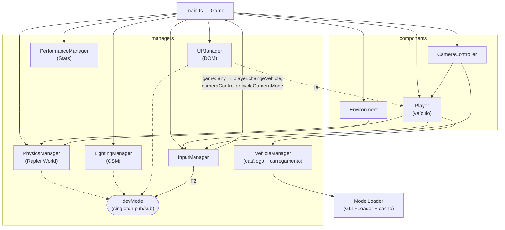
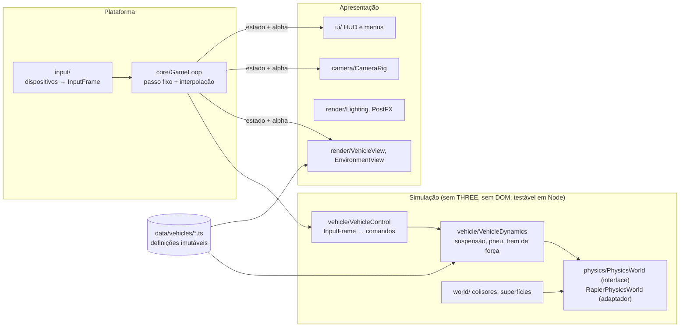

# Arquitetura

Este documento descreve a arquitetura **como ela está no código** e, separadamente, a arquitetura para onde ela deve evoluir. Cada afirmação usa uma das três marcações:

- **[Implementado]** — verificado no código da `master` (e, quando dito, na `refact/rapier3d`).
- **[Planejado]** — evolução recomendada, ainda inexistente.
- **[Investigar]** — questão em aberto que exige análise antes de decidir.

Referência de base: branch `stabilize/rapier` (Rapier, ROADMAP P0-5). A implementação anterior com cannon-es e a `refact/rapier3d` são comparadas no [ADR-0001](docs/decisions/ADR-0001-motor-de-fisica.md).

---

## 1. Visão geral [Implementado]

Aplicação de navegador, sem servidor. Um único bundle Vite carrega `src/main.ts`, que instancia a classe `Game`. `Game` cria todos os subsistemas no construtor, guarda cada um em um campo público e roda um loop com `requestAnimationFrame`.

Não há ECS, injeção de dependência, barramento de eventos nem estado serializável. Os subsistemas recebem referências diretas uns dos outros pelo construtor. O único mecanismo de publicação/assinatura é `DevModeManager` (singleton `devMode`).

Tamanho: ~2,4 mil linhas de TypeScript em 15 arquivos de jogo. Testes: Vitest em Node (`test/`), com cenários de referência do veículo (§3.8).

## 2. Ciclo de execução [Implementado]

`Game.gameLoop` (`src/main.ts`), por quadro:

1. `deltaTime` = tempo real desde o último quadro, limitado a 0,1 s.
2. `inputManager.update()` lê teclado e gamepad.
3. `physicsManager.update(dt)` → acumulador com passo fixo de 1/60 s. A cada passo: guarda a pose anterior das entidades, roda os *pre-step callbacks* (no `Player`: lê o input mais recente, integra o volante, define motor/freio e chama `vehicleController.updateVehicle`) e `world.step()`. Depois, `alpha = acumulador / passo` e os meshes registrados recebem a pose interpolada entre os dois últimos passos; atualiza o debug renderer (sem interpolação).
4. `update(dt)` em `[environment, lightingManager, player, cameraController, performanceManager]`:
   - `Player.update`: só visual — chassi e rodas (suspensão, esterço, giro) interpolados pelo mesmo `alpha`.
   - `CameraController.update`: posiciona a câmera conforme o modo, a partir da pose interpolada do mesh do chassi.
   - `LightingManager.update`: `csm.update()`.
5. `ui.updatePlayerInfo` (só no modo dev).
6. `renderer.render(scene, camera)`.

Consequências:

- Input entra no primeiro passo do quadro (sem quadro de latência); o mesmo roteiro dá a mesma sequência de passos a 30, 60 e 144 FPS (teste em `vehicle-reference.test.ts`).
- O visual fica até 1 passo (16,7 ms) atrás da física, em troca de movimento uniforme a qualquer taxa de quadros.
- A ordem ainda está espalhada entre `Game.gameLoop`, `PhysicsManager.update` e a ordem de `components`; não há módulo `GameLoop` dedicado.

Inicialização assíncrona: `Game.initialize()` aguarda `PhysicsManager.create()` (`RAPIER.init()`, WASM).

## 3. Subsistemas

### 3.1 Física — `src/managers/PhysicsManager.ts` [Implementado]

- `RAPIER.World` (`@dimforge/rapier3d-compat` 0.19.3, WASM embutido no bundle), gravidade −9,82, criado por `PhysicsManager.create()` (assíncrono).
- Passo fixo por acumulador (`world.timestep` igual), 1/60 s por padrão, configurável em `PhysicsManager.create(scene, fixedTimeStep)`; *pre-step callbacks* para lógica que precisa rodar a cada passo.
- Interpolação: pose anterior/atual por entidade (`addEntity`), `getInterpolationAlpha()`, `getInterpolatedPose()`; `resetInterpolation()` após teleporte.
- Passo mantido em 1/60 s (avaliado 1/120 e 1/240 s): frenagem, aceleração e aceleração lateral mudam < 1%; a curva do G63 troca velocidade por guinada (~3% por halving do passo, sem convergir até 1/240 s) e o repouso baixa 3–4 mm. Custo da física desprezível nos dois casos (~6 vs ~9 µs por quadro em Node). Reavaliar no P2-1.
- Criação tipada: `createRigidBody(RigidBodyConfig)`, `createCollider(ColliderConfig)`, `createGroundCollider`; `castRay`.
- Lista `entities` (corpo + mesh) para sincronização visual; `removeEntity` remove o corpo do mundo.
- `PhysicsDebugRenderer`: `world.debugRender()` em `LineSegments` no modo dev (aloca buffers a cada quadro; só em dev).
- Atenção: `RigidBody.linvel()` do chassi apoiado no controlador de veículo não é zero em repouso (~g·dt); meça movimento por deslocamento.

Unidades e eixos ([ADR-0002](docs/decisions/ADR-0002-unidades-e-eixos.md)): **SI**, 1 unidade = 1 m; mundo com +Y para cima. Modelos em escala 1, chassi 4,6 × 1,2 × 1,8 m, massas 1.550 kg (BMW) e 2.500 kg (G63); o HUD mostra km/h reais. A plataforma de 200 m do `Environment` é pequena para essas velocidades (o harness usa um chão de 1 km).

### 3.2 Veículo — `src/components/Player.ts`, `src/managers/VehicleManager.ts` [Implementado]

`Player` concentra:

- criação do chassi (corpo dinâmico + cuboid) e do `DynamicRayCastVehicleController` com 4 rodas;
- leitura do input analógico (`getThrottle/getBrake/getSteer`);
- modelo de direção (rampa do volante, retorno ao centro, redução com a velocidade);
- motor/freio/freio de mão/boost, tração `rear`/`front`/`all`, resistência ao rolamento (`configs.rollingResistance`) sem acelerador nem freio;
- sincronização visual do chassi e das rodas (com ajustes de alinhamento por roda);
- troca de veículo, *reset*, consultas para câmera e UI.

`VehicleManager` contém o **catálogo em código** (`bmw_f82`, `mercedes_g63`): modelo, escala, física, câmeras, parâmetros de condução e posições das rodas; e carrega os glTF com *fallback* para primitivas.

Problemas estruturais:

- **Estado de runtime dentro do catálogo**: `configs.currentSteering`, `currentSpeed` e `boostForce` são gravados no objeto de configuração compartilhado.
- Eixos locais do chassi: frente +X, cima +Y, direita +Z (`Player.LOCAL_FORWARD` etc.); ângulo de esterço positivo vira à esquerda.
- Índices de roda fixos (0/1 dianteiras esquerda/direita, 2/3 traseiras; ímpares espelhadas) sem tipo que os represente.
- Recursos GPU: trocar de veículo libera geometrias e materiais (`Player.releaseObjects`); texturas e o cache do `ModelLoader` não são liberados.
- `loadVehicle` ignora resultados de carregamentos obsoletos (`loadRequestId`).
- O mesh de *placeholder* continua registrado no `PhysicsManager` depois que o modelo real é carregado.

Modelo físico do veículo: *raycast vehicle* (Bullet, via Rapier). Suspensão linear com amortecimento de compressão/relaxamento (rigidez e amortecimento por kg de chassi), atrito por limite de impulso (`frictionSlip`, `sideFrictionStiffness`), freio configurado em N e convertido no impulso por passo que o controlador espera (`força × dt`); unidades em `VehiclePhysicsConfig` e no ADR-0002. Não há equivalente ao `rollInfluence` da cannon-es (o G63 vira com raio maior que antes; ver ADR-0001). Não há modelo de pneu, inércia de roda, trem de força, câmbio, diferencial nem aerodinâmica.

### 3.3 Input — `src/managers/InputManager.ts` [Implementado]

- Mapa ação → teclas; ações imediatas (`TOGGLE_DEV_MODE`, `CYCLE_CAMERA_MODE`, `SELECT_VEHICLE_*`, `RESET_CAR`) chamam métodos de `game` (tipado como `any`).
- Ações contínuas: valores analógicos 0–1 (`getThrottle`, `getBrake`, `getSteer`) de teclado ou gamepad (gatilhos e analógico com *deadzone*), atualizados por `update()` no início do quadro; `isActionActive` para botões.
- Mouse: delta acumulado, pointer lock no clique, tempo desde o último movimento.

### 3.4 Câmera — `src/components/CameraController.ts` [Implementado]

Três modos por veículo (`cameraSettings`): `FIRST_PERSON` (padrão) e `HOOD` presos ao chassi com olhar livre e auto-centralização; `THIRD_PERSON` orbital com mouse. O auto-centro do modo orbital está comentado — a câmera não acompanha a guinada do carro. Ajusta `fov` e chama `updateProjectionMatrix()` todo quadro.

### 3.5 Renderização e iluminação — `src/main.ts`, `src/managers/LightingManager.ts`, `src/components/Environment.ts` [Implementado]

- `WebGLRenderer` com antialias, `shadowMap.type = VSMShadowMap`, `pixelRatio = min(devicePixelRatio, 2)`.
- Pipeline de cor (`RENDER_CONFIG` em `main.ts`): `outputColorSpace = SRGBColorSpace`, *tone mapping* AgX, exposição 1,3 (sobrescrevível com `?exposure=<n>` na URL). AgX foi escolhido em vez de ACES Filmic porque, com `dawn_4k.hdr`, o ACES desloca o azul saturado da pintura para violeta; o AgX preserva o matiz e suaviza o céu, ao custo de um pouco de saturação.
- Câmera perspectiva `near 0.1`, `far 1000` (razão 1e4). Conferido sem recorte no interior dos dois veículos em primeira pessoa na escala atual (~0,5); com a escala SI (P0-6) a folga aumenta. `logarithmicDepthBuffer` não é necessário.
- Céu e `scene.environment`: `dawn_4k.hdr` via `HDRLoader`, `EquirectangularReflectionMapping`. O renderer já converte `scene.environment` equiretangular em PMREM; um `PMREMGenerator` explícito não mudaria o resultado.
- `LightingManager`: CSM do Three em escala SI — 4 cascatas terminando em 10, 26, 64 e 200 m (`maxFar 200`, modo `custom`), shadow map 2048 por cascata (4×2048² contra 3×4096² antes, ~⅓ da memória), `fade` entre cascatas, `lightMargin 50`, `lightFar 600`. `bias −0.00005` (≈3 cm na profundidade de 600 m) e `normalBias` de 1,5 texel calculado por cascata em `updateFrustums()` (≈1,7 cm na primeira, ≈34 cm na última). Texel na primeira cascata ≈1–1,5 cm, conforme o aspecto da tela.
- Luz direcional: cor `0xf6ad8f` e intensidade 5 mantidas. A cor coincide com o brilho do amanhecer no `dawn_4k.hdr` (linear ≈ 1 : 0,48 : 0,27, azimute ≈45°, junto ao horizonte); a elevação de 35° é artística. Medido no HDR: irradiância horizontal do céu ≈3,2 (luminância) contra ≈1,5 do sol — sombras naturalmente suaves; com o plano quase preto (`0x0f0f0f`, albedo ≈0,5%) elas quase não aparecem. Faces iluminadas já chegam ao ombro do AgX, então aumentar o sol sem reduzir exposição ou `environmentIntensity` estoura as cores.
- Materiais: `setupCSMMaterials()` cobre o que existe na inicialização; objetos adicionados à cena depois (veículos, rodas) são configurados pelo evento `childadded` da cena e removidos do mapa do CSM em `childremoved`. Antes disso os materiais dos veículos recebiam as N luzes das cascatas sem a seleção do CSM (N× a luz direta).
- `Environment`: plano 200×200, skybox HDR, 3 caixas dinâmicas.
- Sem pós-processamento, sem reflexos além do mapa de ambiente, sem LOD, sem instancing, sem compressão de texturas (glTF com PNG; `assets` ~49 MB, `textures` ~52 MB).

### 3.6 UI, dev mode, desempenho [Implementado]

- `UIManager`: escreve velocidade/posição/rotação/ângulo de roda no DOM quando o modo dev está ativo. Os botões “BMW M4 / MERCEDES G63” do HTML não têm handler.
- `DevModeManager`: singleton com `localStorage` e assinantes por id.
- `PerformanceManager`: painel `Stats` (FPS).

### 3.7 Código morto [Implementado]

- `src/components/Material.ts` (`MaterialLibrary`): não importado; referencia texturas inexistentes.
- `Player.getMovimentDirection()`: não usado.

### 3.8 Testes — `test/` [Implementado]

- `test/support/sim.ts`: contrato `SimHandle` (quadro, snapshot) e `ScriptedInput`, que substitui o `InputManager` (API binária e analógica).
- `test/support/rapierSim.ts`: `PhysicsManager` + `Player` reais sobre um plano, mesma ordem do `Game.gameLoop`; `ModelLoader` é mockado no teste.
- `test/support/scenarios.ts`: repouso, aceleração, frenagem, curva, 0–100 km/h, frenagem de 100 km/h; métricas puras sobre snapshots. O chão do harness tem 1 km.
- `test/support/baseline.ts` + `test/baselines/rapier.json`: comparação com tolerância (2% relativo, 0,01 absoluto); `UPDATE_BASELINE=1` regrava.
- `test/baselines/cannon-master.json`: medições da implementação anterior (cannon-es), mantidas como referência histórica; não usadas nos testes.
- `vehicle-reference.test.ts` também exige resultados iguais a 30/60/144 FPS e frenagem igual com passo de 1/60 e 1/120 s; `interpolation.test.ts` verifica deslocamento visual uniforme por quadro a 144 Hz.
- `test/physics/vehicle-lifecycle.test.ts`: trocar de veículo 20 vezes não acumula corpos, colisores, controladores nem objetos na cena e libera geometrias; carregamento obsoleto não substitui o veículo atual.
- Os cenários medem o comportamento atual para detectar regressões. `test/physics/vehicle-plausibility.test.ts` impõe limites físicos largos em SI: 0–100 km/h, desaceleração de frenagem, aceleração lateral em curva, repouso estável.

### 3.9 Concorrência

Não há workers nem paralelismo. Tudo roda na thread principal. Carregamento de modelos é assíncrono (Promise) e não sincronizado com o estado do jogador.

---

## 4. Riscos e limitações que bloqueiam a evolução

| # | Problema | Consequência | Antes de… |
|---|---|---|---|
| R1 | Testes cobrem só o veículo em plano; sem lint | Regressões de câmera, render e input só aparecem jogando | refatorar esses subsistemas |
| R2 | ~~Escala ~0,5 e massas arbitrárias~~ Resolvido no P0-6 (ADR-0002). Restam: sem arrasto nem câmbio (velocidade sem teto), centro de massa no centro do collider, plano de 200 m | Faixas plausíveis, mas não um carro real | trabalhar em dinâmica veicular (P2-1) |
| R3 | `Player` com 5 responsabilidades; `main.ts` cria tudo | Dois agentes não conseguem trabalhar em física e input/câmera sem editar o mesmo arquivo | paralelizar trabalho |
| R4 | ~~Input e controle por quadro, sem interpolação~~ — resolvido em P1-1 (§2). Resta: ordem do loop espalhada (sem `GameLoop`), visual 1 passo atrás | — | — |
| R5 | Controlador de veículo embutido (raycast, caixa-preta em WASM) | Teto de qualidade da direção | P2-1 (dinâmica própria) |
| R6 | Estado no catálogo de configuração | Bugs ao trocar/instanciar veículos | múltiplos veículos |
| R7 | Sem ciclo de vida de recursos | Vazamento de GPU/WASM ao trocar veículo | streaming de mundo |
| R8 | ~~Renderizador sem pipeline de cor/tone mapping definidos~~ — resolvido em P2-7 (§3.5) | — | — |

---

## 5. Arquitetura desejada [Planejado]

Princípio: **a simulação é independente da renderização e do DOM**. Ela roda em passos fixos, recebe comandos e produz estado; a renderização apenas lê esse estado (interpolado).

Contratos-chave (a definir no P1, ver ROADMAP):

- `PhysicsWorld`: criar/remover corpos e colisores, `castRay`/`castShape` com filtro, aplicar força/impulso em ponto, ler transformações, `step(dt)`, snapshot. Só o adaptador importa `@dimforge/rapier3d-compat`.
- `VehicleDefinition` (dados, imutável) × `VehicleState` (runtime, por instância).
- `InputFrame`: valores normalizados por passo de simulação (`throttle`, `brake`, `steer`, `handbrake`, …), independentes de dispositivo.
- `SimulationSnapshot` legível pela apresentação: transformações atual e anterior para interpolação, telemetria por roda.
- Unidades SI (metro, quilograma, segundo, radiano, newton) e convenção de eixos única, documentadas no código.

Organização de diretórios proposta (por domínio, não por “manager/component”): `src/core`, `src/physics`, `src/vehicle`, `src/world`, `src/render`, `src/camera`, `src/input`, `src/ui`, `src/data`, `src/debug`. A migração deve ser incremental — mover um subsistema por vez, sem reescrever o que já funciona.

---

## 6. Decisões

| Id | Decisão | Status |
|---|---|---|
| [ADR-0001](docs/decisions/ADR-0001-motor-de-fisica.md) | Motor de física: adotar Rapier por integração curada da `refact/rapier3d` | **Aceita** (2026-11-01) |
| [ADR-0002](docs/decisions/ADR-0002-unidades-e-eixos.md) | Unidades SI e convenção de eixos | **Aceita** (2026-11-01) |
| ADR-0003 | Dinâmica veicular própria sobre a física (substituir o controlador *raycast* embutido) | A redigir (P2) |
| ADR-0004 | Tecnologia de UI (DOM puro × React/Preact sobre o canvas) | A redigir (P2) |

Decisão já implícita no código e mantida: **Three.js imperativo** como camada de renderização, sem React Three Fiber. O loop de simulação em passo fixo e a física não devem depender de um reconciliador de UI. Se a interface (HUD, menus) crescer, React pode ser usado **apenas na camada de UI em DOM**, lendo um snapshot do estado do jogo — ver ADR-0004.

## 7. Questões pendentes [Investigar]

1. Efeito visual de os materiais dos veículos não passarem por `csm.setupMaterial`.
2. WebGL × `WebGPURenderer` (Three r182) para a meta gráfica: custo de migração do CSM/shaders, suporte de navegadores-alvo.
3. Tamanho do bundle com Rapier: pacote não-`compat` com `.wasm` separado.
4. Orçamentos de desempenho (FPS-alvo, hardware-alvo, memória) — não existem medições.
5. Pipeline de assets: compressão (KTX2/Basis, Draco/Meshopt), limites por veículo; os modelos atuais somam ~49 MB.
6. Terreno: `heightfield` × `trimesh` na Rapier para direção (arestas internas, desempenho de consulta).
7. Necessidade de determinismo entre plataformas (replays, fantasmas, rede) — define se usar `rapier3d-deterministic-compat`.
8. Áudio: não existe nenhum sistema de áudio.
