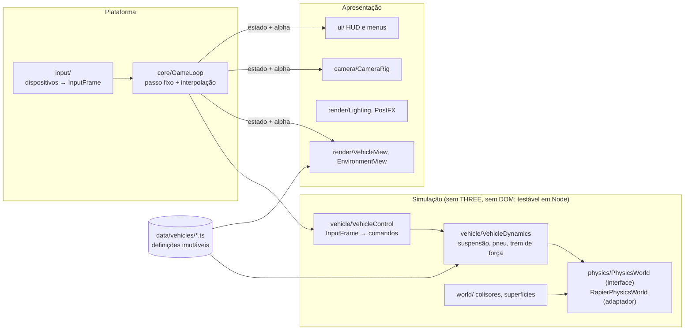

# Arquitetura

Este documento descreve a arquitetura **como ela está no código** e, separadamente, a arquitetura para onde ela deve evoluir. Cada afirmação usa uma das três marcações:

- **[Implementado]** — verificado no código da `master` (e, quando dito, na `refact/rapier3d`).
- **[Planejado]** — evolução recomendada, ainda inexistente.
- **[Investigar]** — questão em aberto que exige análise antes de decidir.

Referência de base: `master` em `390b921`. A branch `refact/rapier3d` (`4d2422a`) é comparada no [ADR-0001](docs/decisions/ADR-0001-motor-de-fisica.md).

---

## 1. Visão geral [Implementado]

Aplicação de navegador, sem servidor. Um único bundle Vite carrega `src/main.ts`, que instancia a classe `Game`. `Game` cria todos os subsistemas no construtor, guarda cada um em um campo público e roda um loop com `requestAnimationFrame`.

Não há ECS, injeção de dependência, barramento de eventos nem estado serializável. Os subsistemas recebem referências diretas uns dos outros pelo construtor. O único mecanismo de publicação/assinatura é `DevModeManager` (singleton `devMode`).

Tamanho: ~2,4 mil linhas de TypeScript em 15 arquivos. Não há testes.

## 2. Ciclo de execução [Implementado]

`Game.gameLoop` (`src/main.ts`), por quadro:

1. `deltaTime` = tempo real desde o último quadro, limitado a 0,1 s.
2. `physicsManager.update(dt)` → `world.step(1/120, dt, 20)` (cannon-es faz os sub-passos fixos) → copia posição/rotação de cada corpo registrado para o mesh correspondente → atualiza o debugger.
3. `update(dt)` em `[environment, lightingManager, player, cameraController, performanceManager]`:
   - `Player.update`: lê teclas, integra o volante com `dt` de quadro (limitado a 1/30), define força de motor/freio no `RaycastVehicle` (efeito no **próximo** passo de física), copia transformações do chassi e das rodas para os meshes.
   - `CameraController.update`: posiciona a câmera conforme o modo.
   - `LightingManager.update`: `csm.update()`.
4. `ui.updatePlayerInfo` (só no modo dev).
5. `renderer.render(scene, camera)`.

Consequências:

- O input é aplicado depois do passo de física — no mínimo **1 quadro de latência**.
- Com sub-passos fixos e sem interpolação, o visual mostra o último passo concluído; com taxas de quadro que não são múltiplas de 120 Hz há *judder* temporal.
- A física de controle (volante) depende da taxa de quadros.

Na `refact/rapier3d`: acumulador próprio a **60 Hz**, `vehicleController.updateVehicle(dt)` dentro de cada passo (*pre-step callback*), `InputManager.update()` adicionado depois do `Player` (mais 1 quadro de latência para o input analógico), inicialização assíncrona por `await RAPIER.init()`.

## 3. Subsistemas

### 3.1 Física — `src/managers/PhysicsManager.ts` [Implementado]

- `CANNON.World`, gravidade −9,82, broadphase SAP, sleeping ligado.
- Materiais `ground` e `wheel` com `ContactMaterial` (friction 0,005); atrito padrão 0,002.
- Lista paralela `bodies[]`/`meshes[]` para sincronização visual. O plano do chão é adicionado direto ao `world`, fora da lista.
- Debugger (`cannon-es-debugger`) criado ao ligar o modo dev; **desligar não remove as linhas** (comentado no código).

Escala do mundo: **não é SI**. Os modelos são carregados com `scale 0.5`, o chassi mede 2,3 × 0,6 × 0,9 unidades (um M4 real mede ~4,7 m), as massas são 200 kg (BMW) e 400 kg (G63). Velocidades exibidas em “km/h” são `m/s × 3,6` sobre essas unidades e não correspondem a velocidades reais.

### 3.2 Veículo — `src/components/Player.ts`, `src/managers/VehicleManager.ts` [Implementado]

`Player` (513 linhas) concentra:

- criação do chassi (`CANNON.Box`) e do `RaycastVehicle` com 4 rodas;
- leitura direta do teclado (`inputManager.isActionActive`);
- modelo de direção (rampa do volante, retorno ao centro, redução com a velocidade);
- motor/freio/freio de mão/boost, tração `rear`/`front`/`all`;
- sincronização visual do chassi e das rodas (com ajustes de alinhamento por roda);
- troca de veículo, *reset*, consultas para câmera e UI.

`VehicleManager` contém o **catálogo em código** (`bmw_f82`, `mercedes_g63`): modelo, escala, física, câmeras, parâmetros de condução e posições das rodas; e carrega os glTF com *fallback* para primitivas.

Problemas estruturais:

- **Estado de runtime dentro do catálogo**: `configs.currentSteering`, `currentSpeed` e `boostForce` são gravados no objeto de configuração compartilhado.
- **Eixo “frente” inconsistente**: a velocidade é calculada contra `(-1,0,0)` e invertida (`* -1`) para exibição.
- Índices de roda fixos (0–1 dianteiras, 2–3 traseiras; ímpares espelhadas) sem tipo que os represente.
- Corrida: `changeVehicle` durante um `loadVehicle` pendente pode adicionar meshes do veículo anterior.
- Recursos GPU (geometrias, materiais, texturas) nunca são liberados.
- O mesh de *placeholder* continua registrado no `PhysicsManager` depois que o modelo real é carregado.

Modelo físico do veículo: *raycast vehicle* (Bullet). Suspensão linear com amortecimento de compressão/relaxamento, atrito por limite de impulso (`frictionSlip`), `rollInfluence` para reduzir capotamento. Não há modelo de pneu, inércia de roda, trem de força, câmbio, diferencial nem aerodinâmica.

### 3.3 Input — `src/managers/InputManager.ts` [Implementado]

- Mapa ação → teclas; ações imediatas (`TOGGLE_DEV_MODE`, `CYCLE_CAMERA_MODE`, `SELECT_VEHICLE_*`, `RESET_CAR`) chamam métodos de `game` (tipado como `any`).
- Ações contínuas consultadas por `isActionActive` (binárias).
- Mouse: delta acumulado, pointer lock no clique, tempo desde o último movimento.

Na `refact/rapier3d`: gamepad (gatilhos e analógico com *deadzone*), valores analógicos 0–1, `update()` por quadro.

### 3.4 Câmera — `src/components/CameraController.ts` [Implementado]

Três modos por veículo (`cameraSettings`): `FIRST_PERSON` (padrão) e `HOOD` presos ao chassi com olhar livre e auto-centralização; `THIRD_PERSON` orbital com mouse. O auto-centro do modo orbital está comentado — a câmera não acompanha a guinada do carro. Ajusta `fov` e chama `updateProjectionMatrix()` todo quadro.

### 3.5 Renderização e iluminação — `src/main.ts`, `src/managers/LightingManager.ts`, `src/components/Environment.ts` [Implementado]

- `WebGLRenderer` com antialias, `shadowMap.type = VSMShadowMap`, `pixelRatio = devicePixelRatio` (sem limite).
- Câmera perspectiva `near 0.01`, `far 1000` — razão de 1e5, propensa a *z-fighting* à distância.
- Sem *tone mapping* configurado; o ambiente é HDR (`dawn_4k.hdr` via `RGBELoader`, que o Three marca como obsoleto em favor de `HDRLoader`).
- `LightingManager`: CSM do Three (3 cascatas, `maxFar 50`, shadow map 4096). `setupCSMMaterials()` é chamado **uma vez**, em `Game.initialize`, antes de os modelos dos veículos terminarem de carregar — os materiais dos veículos não passam por `csm.setupMaterial`. O efeito visual exato está **[Investigar]**.
- `Environment`: plano 200×200, skybox HDR, 3 caixas dinâmicas.
- Sem pós-processamento, sem reflexos além do mapa de ambiente, sem LOD, sem instancing, sem compressão de texturas (glTF com PNG; `assets` ~49 MB, `textures` ~52 MB).

### 3.6 UI, dev mode, desempenho [Implementado]

- `UIManager`: escreve velocidade/posição/rotação/ângulo de roda no DOM quando o modo dev está ativo. Os botões “BMW M4 / MERCEDES G63” do HTML não têm handler.
- `DevModeManager`: singleton com `localStorage` e assinantes por id.
- `PerformanceManager`: painel `Stats` (FPS).

### 3.7 Código morto [Implementado]

- `src/components/Material.ts` (`MaterialLibrary`): não importado; referencia texturas inexistentes.
- `Player.getMovimentDirection()`: não usado.

### 3.8 Concorrência

Não há workers nem paralelismo. Tudo roda na thread principal. Carregamento de modelos é assíncrono (Promise) e não sincronizado com o estado do jogador.

---

## 4. Riscos e limitações que bloqueiam a evolução

| # | Problema | Consequência | Antes de… |
|---|---|---|---|
| R1 | Sem testes, lint ou CI | Regressões de física só aparecem dirigindo | qualquer refatoração |
| R2 | Escala ~0,5 e massas arbitrárias | Parâmetros sem significado físico; tuning se perde ao corrigir a escala | trabalhar em dinâmica veicular |
| R3 | `Player` com 5 responsabilidades; `main.ts` cria tudo | Dois agentes não conseguem trabalhar em física e input/câmera sem editar o mesmo arquivo | paralelizar trabalho |
| R4 | Input e controle por quadro, sem interpolação | Comportamento muda com o FPS; *judder* em monitores > 60 Hz | ajuste fino de direção |
| R5 | Motor da `master` sem manutenção desde 2022 | Custo crescente de ficar | investir em física (ver ADR-0001) |
| R6 | Estado no catálogo de configuração | Bugs ao trocar/instanciar veículos | múltiplos veículos |
| R7 | Sem ciclo de vida de recursos | Vazamento de GPU/WASM ao trocar veículo | streaming de mundo |
| R8 | Renderizador sem pipeline de cor/tone mapping definidos | Ajuste de materiais e iluminação sem referência estável | trabalho gráfico |

---

## 5. Arquitetura desejada [Planejado]

Princípio: **a simulação é independente da renderização e do DOM**. Ela roda em passos fixos, recebe comandos e produz estado; a renderização apenas lê esse estado (interpolado).

Contratos-chave (a definir no P1, ver ROADMAP):

- `PhysicsWorld`: criar/remover corpos e colisores, `castRay`/`castShape` com filtro, aplicar força/impulso em ponto, ler transformações, `step(dt)`, snapshot. Só o adaptador importa `@dimforge/rapier3d-compat`.
- `VehicleDefinition` (dados, imutável) × `VehicleState` (runtime, por instância).
- `InputFrame`: valores normalizados por passo de simulação (`throttle`, `brake`, `steer`, `handbrake`, …), independentes de dispositivo.
- `SimulationSnapshot` legível pela apresentação: transformações atual e anterior para interpolação, telemetria por roda.
- Unidades SI (metro, quilograma, segundo, radiano, newton) e convenção de eixos única, documentadas no código.

Organização de diretórios proposta (por domínio, não por “manager/component”): `src/core`, `src/physics`, `src/vehicle`, `src/world`, `src/render`, `src/camera`, `src/input`, `src/ui`, `src/data`, `src/debug`. A migração deve ser incremental — mover um subsistema por vez, sem reescrever o que já funciona.

---

## 6. Decisões

| Id | Decisão | Status |
|---|---|---|
| [ADR-0001](docs/decisions/ADR-0001-motor-de-fisica.md) | Motor de física: adotar Rapier por integração curada da `refact/rapier3d` | **Aceita** (2026-11-01) |
| ADR-0002 | Unidades SI e convenção de eixos | A redigir (ROADMAP P0-6) |
| ADR-0003 | Dinâmica veicular própria sobre a física (substituir o controlador *raycast* embutido) | A redigir (P2) |
| ADR-0004 | Tecnologia de UI (DOM puro × React/Preact sobre o canvas) | A redigir (P2) |

Decisão já implícita no código e mantida: **Three.js imperativo** como camada de renderização, sem React Three Fiber. O loop de simulação em passo fixo e a física não devem depender de um reconciliador de UI. Se a interface (HUD, menus) crescer, React pode ser usado **apenas na camada de UI em DOM**, lendo um snapshot do estado do jogo — ver ADR-0004.

## 7. Questões pendentes [Investigar]

1. Efeito visual de os materiais dos veículos não passarem por `csm.setupMaterial`.
2. WebGL × `WebGPURenderer` (Three r182) para a meta gráfica: custo de migração do CSM/shaders, suporte de navegadores-alvo.
3. Tamanho do bundle com Rapier: pacote não-`compat` com `.wasm` separado.
4. Orçamentos de desempenho (FPS-alvo, hardware-alvo, memória) — não existem medições.
5. Pipeline de assets: compressão (KTX2/Basis, Draco/Meshopt), limites por veículo; os modelos atuais somam ~49 MB.
6. Terreno: `heightfield` × `trimesh` na Rapier para direção (arestas internas, desempenho de consulta).
7. Necessidade de determinismo entre plataformas (replays, fantasmas, rede) — define se usar `rapier3d-deterministic-compat`.
8. Áudio: não existe nenhum sistema de áudio.
