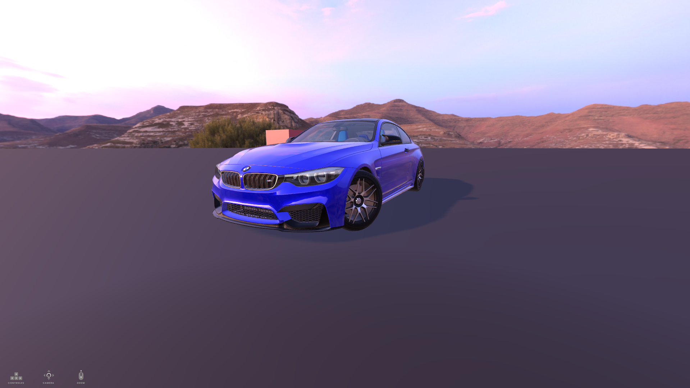

# Three.js Car Game

Protótipo de jogo de direção 3D para navegador, escrito em TypeScript com Three.js (renderização) e um motor de física rígida em JavaScript/WASM. O jogador dirige um veículo (BMW M4 F82 ou Mercedes G63) em um cenário com obstáculos físicos, com três modos de câmera e um modo de desenvolvimento com telemetria e visualização de colisores.



## Objetivo e proposta técnica

A direção de longo prazo é um jogo de direção cuja qualidade percebida — gráfica e de simulação — tenha como referência a série Forza Horizon. Isso é uma **meta de produto**, não uma descrição do estado atual: hoje o projeto é um protótipo com um modelo de veículo do tipo *raycast vehicle* (herdado do Bullet), cenário mínimo e renderização WebGL padrão do Three.js.

A estratégia técnica, as limitações conhecidas e o caminho de evolução estão documentados em:

| Documento | Conteúdo |
|---|---|
| [ARCHITECTURE.md](ARCHITECTURE.md) | Arquitetura real (implementado / planejado / pendente), fluxos, riscos |
| [ROADMAP.md](ROADMAP.md) | Etapas P0–P3, critérios de conclusão, dependências |
| [docs/decisions/ADR-0001-motor-de-fisica.md](docs/decisions/ADR-0001-motor-de-fisica.md) | Comparação `master` (cannon-es) × `refact/rapier3d` (Rapier) e recomendação |
| [CLAUDE.md](CLAUDE.md) | Regras operacionais para o Claude Code |
| [AGENTS.md](AGENTS.md) | Coordenação de múltiplos agentes |

## Tecnologias

| Item | Versão (package.json) | Uso |
|---|---|---|
| [Three.js](https://threejs.org/) | ^0.182.0 | Renderização WebGL, GLTFLoader, RGBELoader, CSM (sombras em cascata), Stats |
| [@dimforge/rapier3d-compat](https://rapier.rs/) | ^0.19.3 | Física (WASM), `DynamicRayCastVehicleController` |
| TypeScript | ^5.9.3 | `strict`, `noUnusedLocals`, `noUnusedParameters` |
| Vite | ^7.3.0 | Servidor de desenvolvimento e build |

Modelos 3D em glTF (`assets/models`), skyboxes HDR e cúbicos (`textures`).

## Pré-requisitos

- Node.js com npm (o projeto usa `package-lock.json`; Vite 7 exige Node 20.19+ ou 22.12+).
- Navegador com WebGL 2.

## Instalação e execução

```bash
npm ci
```

```bash
npm run dev
```

O Vite serve em `http://localhost:5173`. Clique na tela para capturar o mouse (pointer lock).

> Ao trocar para uma branch anterior à migração para Rapier, rode `npm ci` de novo: as dependências diferem.

### Controles

| Ação | Teclado | Gamepad |
|---|---|---|
| Acelerar / frear e ré | W, ↑ / S, ↓ | RT / LT (analógico) |
| Direção | A, ← / D, → | Analógico esquerdo |
| Freio de mão | Espaço | A / X |
| Boost | Shift | RB / R1 |
| Trocar câmera (1ª pessoa → 3ª pessoa → capô) | C, V | Y / Triângulo |
| BMW M4 / Mercedes G63 | 1 / 2 | D-pad ← / → |
| Reposicionar carro | R | Back / Share |
| Modo dev (telemetria, colisores, cascatas de sombra) | F2 | — |

## Build e verificações

| Comando | O que faz |
|---|---|
| `npm run typecheck` | `tsc --noEmit` (verificação estática) |
| `npm run build` | `tsc` + `vite build` → `dist/` |
| `npm run preview` | Serve o build de produção |
| `npm test` | Vitest em Node: cenários de referência da física do veículo |

Os testes montam o veículo real sem navegador e comparam repouso, aceleração, frenagem e curva com a linha de base em `test/baselines/`. Ainda não há lint nem CI. Mudanças na física ou nos controles também exigem um teste manual de direção (ver [CLAUDE.md](CLAUDE.md#validação)).

## Estrutura

```
├── index.html               # Página e overlays (HUD de dev, ícones de controle)
├── css/main.css
├── src/
│   ├── main.ts              # Classe Game: cria subsistemas e roda o loop
│   ├── components/          # Objetos de jogo (GameComponent/Entity)
│   │   ├── Player.ts        # Veículo do jogador: física, direção, sincronização visual
│   │   ├── CameraController.ts
│   │   ├── Environment.ts   # Chão, skybox HDR, obstáculos
│   │   ├── Entity.ts, GameComponent.ts
│   │   └── Material.ts      # Não utilizado (ver ARCHITECTURE.md)
│   ├── managers/            # Serviços: física, input, iluminação, UI, desempenho, dev mode
│   └── loaders/ModelLoader.ts
├── test/                    # Vitest: harness headless, cenários e linhas de base
├── assets/models/           # glTF dos veículos e rodas
├── textures/                # Skyboxes, ícones, screenshot
└── docs/decisions/          # Registros de decisão arquitetural (ADR)
```

## Estado atual

Funcional: carro dirigível (teclado e gamepad), dois veículos, três câmeras, obstáculos dinâmicos, CSM, modo dev. Física em Rapier, migrada da cannon-es com comportamento equivalente medido pelos cenários de referência ([ADR-0001](docs/decisions/ADR-0001-motor-de-fisica.md)). A branch `refact/rapier3d` é apenas referência histórica.

Limitações principais (detalhes em [ARCHITECTURE.md](ARCHITECTURE.md)): o mundo está em escala ~0,5 (carro de 2,3 unidades de comprimento), o modelo de pneu é o atrito simplificado do *raycast vehicle* e não há interpolação entre passos de física.

## Licença

MIT.
