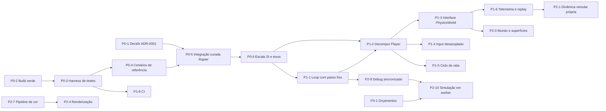

# Roadmap técnico

Ponto de partida: protótipo funcional (ver [ARCHITECTURE.md](ARCHITECTURE.md)), sem testes, com decisão de motor de física pendente ([ADR-0001](docs/decisions/ADR-0001-motor-de-fisica.md)).

Prioridades:

- **P0 — Bloqueadores:** impedem desenvolvimento confiável.
- **P1 — Fundação:** estrutura necessária para evoluir e paralelizar.
- **P2 — Evolução:** novos sistemas e qualidade.
- **P3 — Polimento:** otimização e refinamento.

Esforço relativo (S < M < L < XL) só é indicado quando o código atual dá base para estimar. Não há prazos.

## Como acompanhar

Cada item tem um id (`P0-3`), estado e dono. O coordenador atualiza este arquivo ao abrir, integrar ou bloquear um item (regras em [AGENTS.md](AGENTS.md)). Estados: `[ ]` aberto · `[~]` em andamento · `[x]` concluído · `[!]` bloqueado.

## Grafo de dependências

---

## P0 — Bloqueadores

### [x] P0-1 — Decidir o motor de física

- **Resultado:** ADR-0001 aceito em 2026-11-01 — Rapier por integração curada (P0-5).
- **Objetivo:** escolher a base (recomendação: Rapier por integração curada).
- **Entrega:** ADR-0001 com status `Aceita` ou `Rejeitada` e justificativa.
- **Conclusão:** status atualizado no ADR e em ARCHITECTURE.md §6.
- **Dono:** responsável pelo projeto. Nenhum agente deve iniciar P0-5 antes disso.

### [x] P0-2 — Build verde e comandos padronizados

- **Problema:** `npm run build` falhava na `master` por 4 erros TS6133; o `node_modules` local estava instalado com as dependências da `refact/rapier3d`.
- **Feito:** erros corrigidos (mesmas mudanças da branch Rapier, para não gerar conflito) e script `typecheck` adicionado (`faa06b2`, na `master`).
- `npm ci && npm run build` verdes na checkout local (2026-11-01).
- **Conclusão:** `npm ci && npm run build` sem erros na `master`. **Esforço:** S.

### [x] P0-3 — Harness de testes headless

- **Resultado:** Vitest 5 (`npm test`, `vitest.config.ts`, `test/setup.ts`). O `Player` real roda em Node via `test/support/cannonSim.ts` (hoje `rapierSim.ts`), com `ModelLoader` mockado. Suíte em ~0,5 s.

- **Objetivo:** testar física e lógica em Node, sem navegador.
- **Entregas:** Vitest como devDependency; script `npm test`; um teste trivial do motor escolhido rodando em Node (cannon-es e `@dimforge/rapier3d-compat` funcionam em Node).
- **Dependências:** P0-2.
- **Conclusão:** `npm test` roda em < 30 s localmente e falha quando uma asserção falha.
- **Risco:** a lógica atual está presa a `THREE.Scene`, DOM e `requestAnimationFrame` — os primeiros testes devem montar o mundo físico diretamente, não a classe `Game`. **Esforço:** S.

### [x] P0-4 — Cenários de referência da simulação

- **Resultado:** `test/support/scenarios.ts` (repouso, aceleração, frenagem, curva, dependência de FPS), linha de base `test/baselines/cannon-master.json` com tolerância de 2%. Verificado por mutação: `maxForce` do BMW 300→310 faz 6 testes falharem. Comparação com a Rapier registrada no adendo do ADR-0001.

- **Objetivo:** ter uma linha de base mensurável **antes** de trocar motor ou escala.
- **Entregas:** testes que montam um veículo com a configuração atual e executam N passos fixos, registrando: repouso (deriva e altura do chassi após 10 s), aceleração em reta (velocidade após 1–5 s), frenagem (distância até parar), curva com volante fixo (raio aproximado), estabilidade (sem NaN, sem energia crescente). Resultados salvos como fixtures.
- **Dependências:** P0-3.
- **Conclusão:** cenários rodam nas duas implementações (a da `master` e a da `refact/rapier3d`) e as diferenças estão registradas no ADR-0001.
- **Risco:** extrair a montagem do veículo de `Player` sem alterar comportamento — fazer por função auxiliar de teste, não refatorando o `Player` ainda. **Esforço:** M.

### [x] P0-5 — Integração curada da Rapier

- **Estado:** integrado na `master` (2026-11-01). Terreno procedural e retuning da `refact/rapier3d` ficaram fora.

- **Objetivo:** trazer a parte boa da `refact/rapier3d` sem as regressões.
- **Entregas (commits separados, branch `stabilize/rapier` a partir da `master`):**
  1. Motor: `PhysicsManager`, `PhysicsDebugRenderer`, `main.ts` assíncrono, `Player`/`VehicleManager`/`Environment` adaptados — **com os parâmetros da `master`**.
  2. Correções: remover controlador antigo em `changeVehicle`; 120 Hz; ordem do input; sem `console.log`; sem alocação por quadro.
  3. Input analógico e gamepad.
  4. (Opcional) terreno procedural atrás de opção, com plano como padrão.
  5. Retuning, em commit próprio.
- **Fora do escopo:** `assets/models/mclaren_f1_2021`, `assets/models/mercedes_amg_one`.
- **Testes:** `test/support/rapierSim.ts`, linha de base `rapier.json`, `vehicle-lifecycle.test.ts`.
- **Dependências:** P0-1, P0-4.
- **Conclusão:** critérios de estabilização do ADR-0001 atendidos; cenários de referência comparados. **Esforço:** M.

### [x] P0-6 — Escala SI e convenção de eixos (ADR-0002)

- **Resultado:** ADR-0002 aceito (branch `feat/si-scale`). 1 unidade = 1 m; frente do chassi +X, direita +Z; BMW 1.550 kg (modelo 4,70 m), G63 2.500 kg; HUD em km/h reais. Plausibilidade testada: 0–100 km/h BMW 4,4 s / G63 5,1 s; frenagem de 100 km/h 9,0 / 8,6 m/s²; curva 1,07 / 0,92 g. Pendentes fora do escopo: arrasto/câmbio (P2-1), plano de 200 m pequeno para velocidades reais (P2-3).
- **Problema:** mundo em escala ~0,5, massas arbitrárias, “frente” = `-X` invertida.
- **Entregas:** ADR-0002; veículos com dimensões e massas reais (1 unidade = 1 m); eixo de avanço único; câmeras e ajustes visuais reescalados; cenários de referência atualizados.
- **Dependências:** P0-5 (evita fazer duas vezes).
- **Conclusão:** chassi do BMW ≈ 4,7 m e massa ≈ 1.500–1.700 kg; HUD mostra velocidade real; todos os testes verdes. **Risco:** todo o tuning atual deixa de valer. **Esforço:** M.

---

## P1 — Fundação

### [x] P1-1 — Loop com passo fixo e interpolação

- **Resultado:** volante e forças no pré-passo com o input mais recente (30/60/144 FPS iguais, teste); freio em N convertido por `dt` (frenagem igual a 1/60 e 1/120 s, teste); interpolação de chassi e rodas pelo `alpha` do acumulador, câmera na pose interpolada. Passo mantido em 1/60 s (ARCHITECTURE §3.1). Não foi criado `core/GameLoop`: a ordem continua em `Game.gameLoop` + `PhysicsManager.update` (hoje `RapierPhysicsWorld.update`).

- **Entregas:** `core/GameLoop`: input amostrado por passo; ordem explícita (input → N passos de simulação → interpolação → câmera → render); estado anterior/atual para interpolação visual.
- **Dependências:** P0-6.
- **Conclusão:** o mesmo roteiro de entrada produz o mesmo resultado a 30, 60 e 144 FPS simulados (teste); sem *judder* visível a 144 Hz.

### [x] P1-2 — Decompor `Player`

- **Resultado:** catálogo congelado em `src/data/vehicles` (`VehicleDefinition`) e `VehicleState` por instância; `vehicle/VehicleControl` (input → comandos, sem THREE, testes unitários), `vehicle/VehiclePhysics` (chassi + controlador Rapier, THREE só para matemática), `render/VehicleView` (meshes, interpolação, carregamento e liberação na GPU). `Player` (~150 linhas) só orquestra; linha de base `rapier.json` inalterada. Restavam o input (P1-4, concluído) e o Rapier em `VehiclePhysics` (P1-3, concluído).

- **Entregas:** `VehicleDefinition` (dados imutáveis) separada de `VehicleState`; `VehicleControl` (input → comandos, volante), `VehiclePhysics` (adaptador do veículo), `VehicleView` (meshes e sincronização), carregamento de assets fora do `Player`. Catálogo movido para `src/data/vehicles`.
- **Dependências:** P1-1.
- **Conclusão:** nenhum módulo de simulação importa `three` para renderização (só matemática, se necessário); cenários de referência inalterados; `Player.ts` deixa de ser ponto de conflito.
- **Esforço:** L.

### [x] P1-3 — Interface `PhysicsWorld`

- **Resultado:** `src/physics/PhysicsWorld.ts` (contrato) e `RapierPhysicsWorld` com `RapierBody`/`RapierVehicle`/`PhysicsDebugRenderer`; `PhysicsManager` absorvido. `grep @dimforge` só acha `src/physics/`. Linha de base idêntica (tolerância zero). Fora da interface por falta de uso: `castShape`, filtros de colisão, força/impulso em ponto, snapshot.

- **Entregas:** interface estreita (ARCHITECTURE §5) e adaptador Rapier; só o adaptador importa o motor.
- **Conclusão:** `grep` por `@dimforge` encontra apenas `src/physics/`.

### [x] P1-4 — Input desacoplado

- **Resultado:** `src/input/`: contrato `InputFrame` (+ `LookInput` do mouse) reescrito uma vez por quadro e lido por `Player`/`VehicleControl` e `CameraController`; ações discretas como eventos tipados (`on(action, handler)`) assinados em `main.ts`; teclas e botões em `InputBindings` (dados). Linha de base `rapier.json` inalterada; testes em `test/input/`.
- **Entregas:** `InputFrame` tipado; ações discretas como eventos/comandos tratados por quem é dono (sem `game: any`); remapeamento por dados.
- **Conclusão:** `InputManager` não importa nem referencia `Game`, `Player` ou `CameraController`.

### [x] P1-5 — Ciclo de vida de recursos

- **Resultado:** cache do `ModelLoader` com contagem de uso; texturas liberadas; `Environment.dispose`; `LightingManager.dispose` e helper do CSM corrigidos. 20 trocas mantêm `renderer.info.memory` constante (teste em `test/render/` e medição no navegador); corpos/colisores/controladores em `vehicle-lifecycle.test.ts`. Materiais carregados já passavam pelo CSM via `childadded`; carregamento obsoleto é descartado (não cancelado).

- **Entregas:** `dispose()` consistente (GPU e WASM); cancelamento de carregamento ao trocar veículo; materiais carregados passam por `LightingManager.setupMaterial`.
- **Conclusão:** trocar de veículo 20 vezes mantém constantes `renderer.info.memory` e o número de corpos/colisores/controladores (teste ou verificação documentada).

### [x] P1-6 — Telemetria, debug e replay

- **Entregas:** HUD de dev com dados por roda (contato, compressão, forças); gravação de `InputFrame` + snapshot inicial; reprodução determinística em teste.
- **Conclusão:** um replay gravado reproduz a mesma trajetória (tolerância definida) em Node.
- **Resultado:** `VehicleTelemetry` por passo em `VehiclePhysics` (HUD F2 a 10 Hz); `src/replay/` (gravação por passo em buffers pré-alocados, estado inicial do chassi). `test/replay/`: trajetória igual bit a bit (tolerância zero) em mundo novo, com taxas de quadro diferentes na gravação e na reprodução.

### [x] P1-7 — Lint e formatação

- **Motivo:** o código mistura tabs e espaços e estilos de declaração. Adicionar ESLint (typescript-eslint) e formatação só com regras que o código atual consiga cumprir, aplicadas em um commit isolado.
- **Conclusão:** `npm run lint` verde e incluído na validação.
- **Resultado:** ESLint 10 + typescript-eslint (`recommended` + `no-floating-promises`, `no-misused-promises`, `await-thenable`, `eqeqeq`, `prefer-const`) em `eslint.config.mjs`; Prettier (tabs, largura 120) aplicado em um commit `style`; `lint` e `format:check` no CI. Restam 4 avisos de `no-explicit-any` em `src/`.

### [x] P1-8 — CI

- **Resultado:** `.github/workflows/ci.yml` (Node 22: `npm ci`, typecheck, test, build).

- **Entregas:** workflow que roda `npm ci`, `typecheck`, `test`, `build` em cada PR.
- **Dependências:** P0-3.

---

## P2 — Evolução

### [x] P2-1 — Dinâmica veicular própria (ADR-0003)

- **Estado:** ADR-0003 (aceito em 2026-11-02) define 4 etapas. **Etapa 1 feita:** `vehicle/Powertrain` (curva de torque, lenta, corte, câmbio automático com histerese, diferencial, ré, limitador, inércia do motor, boost ≤ ×1,5 no torque), arrasto 0,5·ρ·Cd·A·v² por `PhysicsBody.applyImpulse`, limite de tração por roda, rpm e marcha na telemetria/HUD/replay. Medido: 0–100 BMW 4,15 s / G63 5,43 s; máxima 272,7 / 216,7 km/h. **Etapa 2 feita:** `PhysicsWorld.castRayWithNormal`, `applyImpulseAtPoint`, `getVelocityAtPoint`; `vehicle/Suspension` (mola N/m, amortecedor de compressão/extensão N·s/m, batente progressivo, barra estabilizadora por eixo) aplicada no ponto de fixação; controlador Rapier só com pneus (suspensão neutralizada, carga normal injetada). Parâmetros convertidos de por-kg para absolutos (mesma frequência natural). Testes analíticos de carga estática, frequência, amortecimento, batente, rigidez de rolagem. Medido: 0–100 4,22 / 5,37 s, curva 1,08 / 0,86 g, repouso 6–8 mm mais baixo (ADR-0003). **Etapa 3 feita:** `vehicle/Tire` (Pacejka simplificado por direção, atrito combinado por escorregamento normalizado, regularização parado), `vehicle/WheelDynamics` (ω com inércia da roda e do motor refletido, Euler implícito por busca de raiz, freio de Coulomb em N·m), forças das quatro rodas no mesmo estado com impulso no contato; controlador Rapier removido do veículo e do contrato; centro de massa baixo (`ColliderConfig.centerOfMass`); freio por eixo e freio de mão que trava. Medido: 0–100 4,37 / 5,87 s, frenagem 8,6 / 8,3 m/s², skidpad 0,98 / 0,81 g, rolagem igual ao analítico (±0,3%) e a barra reduz 43/41%; custo ~20 µs por passo (antes ~13). **Etapa 4 feita:** `vehicle/Driveline` (motor com inércia e rotação própria, embreagem de Coulomb, conversor com estol e multiplicação no G63, árvore de diferenciais com repartição e bloqueio por torque, pré-carga e viscoso; autoblocante traseiro no BMW, central 40/60 com bloqueio no G63), `vehicle/Engine` (freio-motor, controle de lenta, corte), embreagem progressiva e aceleração na troca; solução implícita no passo de 1/60 s (Newton com as rodas linearizadas, sem subpassos). μx do G63 mantido em 1,0 por decisão do usuário, com a faixa de plausibilidade do G63 em 4,0–6 s. Medido: 0–100 4,40 / 4,27 s, frenagem 8,5 / 8,5 m/s², skidpad 0,99 / 0,83 g; dianteiras do G63 patinam 0,47 contra 0,67; autoblocante reduz a diferença entre as traseiras de 2,23 para 0,13 rad/s; freio-motor 1,38 / 1,22 m/s² contra 0,57 / 0,52 em ponto morto; custo ~24 µs por passo (antes ~19). Controle de tração/ESC no P2-2.
- **Objetivo:** substituir o controlador *raycast* embutido por um modelo próprio sobre o corpo rígido.
- **Entregas, em ordem:** suspensão por roda (mola, amortecedor, *bump stop*, barra estabilizadora) com shape cast; modelo de pneu com escorregamento longitudinal/lateral e atrito combinado; inércia de roda; trem de força (curva de torque, câmbio, diferencial); freios e freio de mão; aerodinâmica; geometria de direção.
- **Validação:** testes contra resultados analíticos (frequência natural da suspensão, carga estática por roda, força lateral em regime) e cenários de referência; telemetria do P1-6.
- **Dependências:** P1-3, P1-6.
- **Risco:** é o item de maior risco do projeto; deve avançar por sub-itens, cada um validado antes do próximo. **Esforço:** XL.

### [ ] P2-2 — Assistências e sensação de direção

- Assistências opcionais (ABS, TCS, ESC), resposta de volante por velocidade, *force feedback* via Gamepad API se disponível. Depende de P2-1.

### [ ] P2-3 — Mundo e superfícies

- Terreno (`heightfield`), materiais de superfície ligados a colisores e ao modelo de pneu, obstáculos estáticos e dinâmicos, pista/mapa de teste.
- Base para streaming de mundo (chunks) quando houver mapa maior que a área atual.

### [ ] P2-4 — Renderização

- Correção do CSM nos materiais carregados; reflexos (env map por área ou *probes*); pós-processamento (bloom, AA temporal ou SMAA, *motion blur* opcional); céu/atmosfera; LOD e instancing.
- **Decisão prévia:** WebGL × WebGPU (ARCHITECTURE §7, item 2) — WebGL2 (ADR-0006).
- **Parcial (2026-11-03):** pós-processamento (bloom só no sol, SMAA/FXAA, presets por URL); céu e reflexos seguem no HDR (céu procedural testado e rejeitado). Faltam: CSM nos materiais carregados, reflexos por área, AA temporal, LOD e instancing.
- **Dependências:** P2-7.
- **Feito (parcial):** CSM em escala SI (4 cascatas até 200 m, 2048, *fade*, *normal bias* por texel) e CSM aplicado aos materiais adicionados depois da inicialização (ARCHITECTURE §3.5). Luz direcional revista e mantida. Pendente: albedo do plano (`0x0f0f0f` esconde as sombras) e, se quiser sombras mais marcadas, sol mais forte com exposição/`environmentIntensity` menores.

### [x] P2-5 — Câmeras

- Câmera de perseguição com inércia, *look-ahead*, colisão com cenário; auto-centro no modo orbital.
- **Câmera pelo analógico direito do gamepad:** orbitar e olhar em volta pelo analógico, como hoje o mouse faz.
  - O analógico entra no `LookInput` (`InputManager`) como taxa em rad/s, com zona morta e curva de resposta, e não como delta por quadro.
  - O auto-centro já existente volta a câmera ao soltar o analógico.
  - Funciona nos três modos de câmera.
  - **Decidido (2026-11-02):** analógico **direito**; o esquerdo continua na direção (`steerAxis`).
  - **Conclusão:** teste de `InputManager` com gamepad simulado (taxa, zona morta, sem conflito com a direção); roteiro manual com controle real.
- **Feito:** `camera/ChaseCamera` (ARCHITECTURE §3.4) e analógico direito no `LookInput`. Testes em `test/camera/` e `test/input/`. Jogo conferido com teclado; roteiro com controle padrão real e colisão com as caixas **não** feitos manualmente.

### [ ] P2-6 — UI (ADR-0004)

- Decidir DOM puro × React/Preact sobre o canvas; HUD de corrida, menus, seleção de veículo.
- **Parcial (2026-11-03):** React 19 (ADR-0004); HUD de corrida (rpm, velocidade, marcha) em `src/ui/`, testes em `test/ui/`. Faltam menus e seleção de veículo.

### [x] P2-7 — Pipeline de cor e iluminação

- Tone mapping explícito, exposição, espaço de cor, `HDRLoader` no lugar do `RGBELoader` obsoleto; câmera com razão near/far adequada (ou *logarithmic depth*).
- **Feito:** AgX com exposição 1,3 (`?exposure=` para ajuste), `SRGBColorSpace` explícito, `HDRLoader` com mapeamento de reflexão, `pixelRatio ≤ 2`, `near 0.1`/`far 1000` sem *logarithmic depth* (ARCHITECTURE §3.5). Intensidade das luzes não foi reajustada.

### [x] P2-8 — Áudio

- Motor (por RPM/carga), pneus (por escorregamento), impactos, ambiente. Depende de P2-1 para os sinais.
- **Resultado:** áudio procedural em Web Audio, sem assets nem dependência (`src/audio/`, ARCHITECTURE §3.6.1): motor por ordem de ignição e carga, perfil por veículo em `VehicleDefinition.sound` (S55 seis cilindros, M177 V8 com meia ordem forte); chiado dos pneus acima do pico de escorregamento; vento e rolamento por velocidade; impacto por pico de aceleração. Tecla `M` liga/desliga. Testes do mapeamento em `test/audio/`. No navegador: contexto ativo após o primeiro gesto, nível e frequência sobem com acelerador e rpm, `M` suspende. Não avaliado de ouvido nem com controle; sem som espacial nem por superfície (P2-3).

### [x] P2-9 — Debug físico sincronizado com a pose interpolada

- **Resultado:** `PhysicsDebugRenderer` monta um `LineSegments` por colisor (arestas da forma no espaço do corpo), uma vez, e por quadro só posiciona o grupo de cada corpo na pose interpolada (`RapierPhysicsWorld.debugPose`). Reconstrução só quando um colisor é criado ou um corpo removido. Testes em `test/physics/debug-renderer.test.ts`. O erro `computeBoundingSphere ... NaN` ao carregar com o modo dev ligado sumiu. Colisores sem forma suportada (trimesh, heightfield) não aparecem até o P2-3.

- **Problema:** desde o P1-1 as meshes são interpoladas e ficam até 1 passo atrás da física, mas o `PhysicsDebugRenderer` desenha `world.debugRender()` cru, sem interpolar. A diferença chega a v·dt (0,93 m a 200 km/h com passo de 1/60 s). Em telas acima de 60 Hz as linhas só se movem nos quadros que tiveram passo, e o resultado é um “salto” que aumenta com a velocidade. Além disso, `update()` cria um `BufferAttribute` novo por quadro, o que gera lixo para o GC. Não é custo de cálculo: o passo de um carro leva bem menos de 1 ms.
- **Entregas:**
  - linhas de debug geradas uma vez por passo, no pós-passo, e não por quadro;
  - buffer de posições reaproveitado (cresce só quando falta espaço, com `setDrawRange`);
  - colisores de corpos dinâmicos registrados desenhados na pose interpolada, aplicando a transformação delta interpolada × atual⁻¹ por corpo. Os estáticos não precisam disso.
- **Conclusão:**
  - wireframe do chassi coincide com a mesh a 250 km/h em 60 e 144 Hz (screenshot);
  - nenhuma alocação por quadro no modo dev.
- **Esforço:** P.

### [ ] P2-10 — Simulação em Web Worker (ADR-0005)

**Objetivo:** tirar a simulação (Rapier, `VehicleControl`, trem de força, replay) da thread principal. Assim um passo lento (vários carros de IA, colisores de mundo grande, P2-3) não derruba o FPS, e a thread principal fica com input, renderização, áudio e UI.

**Diagnóstico de partida:**
- Hoje o gargalo não é a física. O que já existe:
  - passo fixo de 1/60 s com acumulador;
  - interpolação por `alpha` (P1-1);
  - `PhysicsWorld` como fronteira única (P1-3).
- O item só se paga quando o tempo do passo medido (P3-1) passar de ~2 ms, ou quando houver mais de um veículo simulado. A preparação (W1) vale antes disso, porque separa simulação e apresentação (ARCHITECTURE §5).

**Desenho**, adaptado de propostas genéricas (postMessage por quadro, Comlink, *client-side prediction*) para um jogo local de um jogador:

| Tema | Decisão | Por quê |
|---|---|---|
| Comunicação de estado | `SharedArrayBuffer` com **3 snapshots** (tripla bufferização) de layout fixo em `Float64Array`. Cada snapshot leva tempo de simulação, número do passo, pose de cada corpo registrado e estado visual das rodas. O índice do snapshot pronto é publicado com `Atomics.store`. | Leitura sem cópia nem lixo; o worker nunca escreve no snapshot que a thread principal está lendo. |
| Suavidade | **Interpolação** entre os dois últimos snapshots pelo relógio de simulação, como no P1-1. | *Client-side prediction* serve para latência de rede; num jogo local, extrapolar causaria erro visual sem ganho. |
| Input | `InputFrame` escrito em uma região do mesmo SAB (`Atomics.store` por campo, contador de sequência), lido pelo worker no pré-passo. | Latência ≤ 1 passo, igual à de hoje. |
| Relógio | A thread principal publica no SAB o tempo-alvo de cada quadro e chama `Atomics.notify`; o worker espera com `Atomics.wait` e avança passos fixos até o alvo. | A simulação do quadro N roda enquanto o quadro N−1 é renderizado. Sem `setInterval` com *jitter*. |
| Eventos raros | `postMessage` para troca de veículo, reset, gravar/reproduzir replay, telemetria do HUD (~10 Hz) e debug (sob demanda, com `Float32Array` transferível). | Baixa frequência, sem custo relevante. |
| Dependências | Nenhuma: sem Comlink. A API de mensagens fica restrita a poucos comandos tipados. | Princípio 8 do CLAUDE.md; bundle igual. |
| Fallback | Implementação local (a atual) com o mesmo contrato. É usada quando `crossOriginIsolated` é falso e nos testes em Node. | SAB exige COOP/COEP; GitHub Pages não envia esses cabeçalhos. |
| Determinismo | Os mesmos módulos de simulação rodam no worker e em Node. Replay e cenários de referência continuam testáveis sem navegador. | Mantém a rede de proteção dos P0-3/P0-4. |

**Etapas** (cada uma integrada e verde antes da próxima):
- **W0 — Medir:** tempo de passo, tempo de quadro e GC no modo dev (P3-1). Registrar a linha de base e definir a meta.
- **W1 — Contrato de snapshot, sem worker:** `SimulationSnapshot` (layout no SAB ou em `ArrayBuffer` comum) e `SimulationHost` com `LocalSimulation`. `VehicleView`, `CameraController`, `UIManager` e debug passam a ler só do snapshot, não de `PhysicsBody` nem de `VehiclePhysics`. Refatoração sem mudança de comportamento, coberta por teste de igualdade snapshot × leitura direta.
- **W2 — COOP/COEP:** cabeçalhos no `vite.config` (dev e preview) e documentação de hospedagem. Se o destino não permitir esses cabeçalhos, decidir no ADR-0005 entre aceitar o fallback e usar um service worker de isolamento.
- **W3 — `WorkerSimulation` atrás de `?sim=worker`:**
  - Rapier e o loop de passo dentro do worker;
  - input e relógio pelo SAB;
  - comandos por mensagem;
  - assets e física de colisores enviados como descrição serializável (dimensões, massas), nunca objetos Three.js.
- **W4 — Padrão:** worker ligado quando `crossOriginIsolated` é verdadeiro, local caso contrário; dev mode mostra qual backend está ativo.

**Conclusão:**
- quadro sem passo de física na thread principal (perfil do navegador);
- carro e debug sem saltos em 60/144/240 Hz;
- latência de input ≤ 1 passo + 1 quadro, medida com input sintético no worker × local;
- passo lento artificial (5 ms) não altera o FPS;
- todos os testes verdes com `LocalSimulation`;
- tamanho do bundle registrado.

**Dependências:** P2-9 (debug por passo), P3-1 (medição). W1 pode começar depois da etapa 2 do P2-1, para não conflitar com `VehiclePhysics`.

**Riscos:**
- W1 toca `Player`, `VehicleView` e `CameraController`, que são pontos de conflito: precisa de escopo exclusivo;
- WASM da Rapier instanciado no worker (verificar o `rapier3d-compat` com Vite `worker.format: "es"`);
- depuração mais difícil.

**Esforço:** L.

---

## P3 — Polimento

- [ ] **P3-1 Orçamentos de desempenho:** definir hardware-alvo e metas (FPS, tempo de CPU por passo, memória, tamanho de download); medir antes de otimizar.
- [ ] **P3-2 Assets:** compressão de texturas e geometria; limites por veículo; carregamento progressivo.
- [ ] **P3-3 Bundle:** Rapier com `.wasm` separado; *code splitting*.
- [ ] **P3-4 Qualidade visual em movimento:** AA temporal, *ghosting*, estabilidade de sombras.
- [ ] **P3-5 Remover código morto** remanescente e consolidar documentação.

---

## Critérios para iniciar implementações paralelas

O projeto só deve receber trabalho de vários agentes em paralelo (em arquivos de código) quando:

1. P0-1 a P0-5 concluídos (motor decidido e integrado; testes e cenários de referência existem).
2. P1-2 concluído — **atendido**: `Player.ts` deixou de ser ponto de edição obrigatório para física, controle e render do veículo; `main.ts` continua sendo o ponto de ligação (input e câmera já não dependem de `Game`, P1-4).
3. `npm run build` e `npm test` verdes na `master`.
4. Contratos de P1-3 e P1-4 documentados no código e em ARCHITECTURE.md.

Antes disso, paralelizar apenas: documentação, investigações (itens `[Investigar]`), testes novos em arquivos novos, e trabalho de renderização que não toque `main.ts`; `Player.ts` só muda quando a ligação entre as peças do veículo muda.
