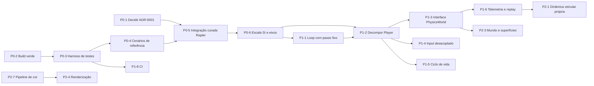

# Roadmap técnico

Ponto de partida: protótipo funcional (ver [ARCHITECTURE.md](ARCHITECTURE.md)), sem testes, com decisão de motor de física pendente ([ADR-0001](docs/decisions/ADR-0001-motor-de-fisica.md)).

Prioridades:

- **P0 — Bloqueadores:** impedem desenvolvimento confiável.
- **P1 — Fundação:** estrutura necessária para evoluir e paralelizar.
- **P2 — Evolução:** novos sistemas e qualidade.
- **P3 — Polimento:** otimização e refinamento.

Esforço relativo (S < M < L < XL) só é indicado quando o código atual dá base para estimar. Não há prazos.

## Como acompanhar

Cada item tem um id (`P0-3`), estado e dono. O coordenador atualiza este arquivo ao abrir, integrar ou bloquear um item (regras em [AGENTS.md](AGENTS.md)). Estados: `[ ]` aberto · `[~]` em andamento · `[x]` concluído · `[!]` bloqueado.

## Grafo de dependências

---

## P0 — Bloqueadores

### [x] P0-1 — Decidir o motor de física

- **Resultado:** ADR-0001 aceito em 2026-11-01 — Rapier por integração curada (P0-5).
- **Objetivo:** escolher a base (recomendação: Rapier por integração curada).
- **Entrega:** ADR-0001 com status `Aceita` ou `Rejeitada` e justificativa.
- **Conclusão:** status atualizado no ADR e em ARCHITECTURE.md §6.
- **Dono:** responsável pelo projeto. Nenhum agente deve iniciar P0-5 antes disso.

### [x] P0-2 — Build verde e comandos padronizados

- **Problema:** `npm run build` falhava na `master` por 4 erros TS6133; o `node_modules` local estava instalado com as dependências da `refact/rapier3d`.
- **Feito:** erros corrigidos (mesmas mudanças da branch Rapier, para não gerar conflito) e script `typecheck` adicionado (`faa06b2`, na `master`).
- `npm ci && npm run build` verdes na checkout local (2026-11-01).
- **Conclusão:** `npm ci && npm run build` sem erros na `master`. **Esforço:** S.

### [x] P0-3 — Harness de testes headless

- **Resultado:** Vitest 5 (`npm test`, `vitest.config.ts`, `test/setup.ts`). O `Player` real roda em Node via `test/support/cannonSim.ts` (hoje `rapierSim.ts`), com `ModelLoader` mockado. Suíte em ~0,5 s.

- **Objetivo:** testar física e lógica em Node, sem navegador.
- **Entregas:** Vitest como devDependency; script `npm test`; um teste trivial do motor escolhido rodando em Node (cannon-es e `@dimforge/rapier3d-compat` funcionam em Node).
- **Dependências:** P0-2.
- **Conclusão:** `npm test` roda em < 30 s localmente e falha quando uma asserção falha.
- **Risco:** a lógica atual está presa a `THREE.Scene`, DOM e `requestAnimationFrame` — os primeiros testes devem montar o mundo físico diretamente, não a classe `Game`. **Esforço:** S.

### [x] P0-4 — Cenários de referência da simulação

- **Resultado:** `test/support/scenarios.ts` (repouso, aceleração, frenagem, curva, dependência de FPS), linha de base `test/baselines/cannon-master.json` com tolerância de 2%. Verificado por mutação: `maxForce` do BMW 300→310 faz 6 testes falharem. Comparação com a Rapier registrada no adendo do ADR-0001.

- **Objetivo:** ter uma linha de base mensurável **antes** de trocar motor ou escala.
- **Entregas:** testes que montam um veículo com a configuração atual e executam N passos fixos, registrando: repouso (deriva e altura do chassi após 10 s), aceleração em reta (velocidade após 1–5 s), frenagem (distância até parar), curva com volante fixo (raio aproximado), estabilidade (sem NaN, sem energia crescente). Resultados salvos como fixtures.
- **Dependências:** P0-3.
- **Conclusão:** cenários rodam nas duas implementações (a da `master` e a da `refact/rapier3d`) e as diferenças estão registradas no ADR-0001.
- **Risco:** extrair a montagem do veículo de `Player` sem alterar comportamento — fazer por função auxiliar de teste, não refatorando o `Player` ainda. **Esforço:** M.

### [x] P0-5 — Integração curada da Rapier

- **Estado:** integrado na `master` (2026-11-01). Terreno procedural e retuning da `refact/rapier3d` ficaram fora.

- **Objetivo:** trazer a parte boa da `refact/rapier3d` sem as regressões.
- **Entregas (commits separados, branch `stabilize/rapier` a partir da `master`):**
  1. Motor: `PhysicsManager`, `PhysicsDebugRenderer`, `main.ts` assíncrono, `Player`/`VehicleManager`/`Environment` adaptados — **com os parâmetros da `master`**.
  2. Correções: remover controlador antigo em `changeVehicle`; 120 Hz; ordem do input; sem `console.log`; sem alocação por quadro.
  3. Input analógico e gamepad.
  4. (Opcional) terreno procedural atrás de opção, com plano como padrão.
  5. Retuning, em commit próprio.
- **Fora do escopo:** `assets/models/mclaren_f1_2021`, `assets/models/mercedes_amg_one`.
- **Testes:** `test/support/rapierSim.ts`, linha de base `rapier.json`, `vehicle-lifecycle.test.ts`.
- **Dependências:** P0-1, P0-4.
- **Conclusão:** critérios de estabilização do ADR-0001 atendidos; cenários de referência comparados. **Esforço:** M.

### [x] P0-6 — Escala SI e convenção de eixos (ADR-0002)

- **Resultado:** ADR-0002 aceito (branch `feat/si-scale`). 1 unidade = 1 m; frente do chassi +X, direita +Z; BMW 1.550 kg (modelo 4,70 m), G63 2.500 kg; HUD em km/h reais. Plausibilidade testada: 0–100 km/h BMW 4,4 s / G63 5,1 s; frenagem de 100 km/h 9,0 / 8,6 m/s²; curva 1,07 / 0,92 g. Pendentes fora do escopo: arrasto/câmbio (P2-1), plano de 200 m pequeno para velocidades reais (P2-3).
- **Problema:** mundo em escala ~0,5, massas arbitrárias, “frente” = `-X` invertida.
- **Entregas:** ADR-0002; veículos com dimensões e massas reais (1 unidade = 1 m); eixo de avanço único; câmeras e ajustes visuais reescalados; cenários de referência atualizados.
- **Dependências:** P0-5 (evita fazer duas vezes).
- **Conclusão:** chassi do BMW ≈ 4,7 m e massa ≈ 1.500–1.700 kg; HUD mostra velocidade real; todos os testes verdes. **Risco:** todo o tuning atual deixa de valer. **Esforço:** M.

---

## P1 — Fundação

### [x] P1-1 — Loop com passo fixo e interpolação

- **Resultado:** volante e forças no pré-passo com o input mais recente (30/60/144 FPS iguais, teste); freio em N convertido por `dt` (frenagem igual a 1/60 e 1/120 s, teste); interpolação de chassi e rodas pelo `alpha` do acumulador, câmera na pose interpolada. Passo mantido em 1/60 s (ARCHITECTURE §3.1). Não foi criado `core/GameLoop`: a ordem continua em `Game.gameLoop` + `PhysicsManager.update` (hoje `RapierPhysicsWorld.update`).

- **Entregas:** `core/GameLoop`: input amostrado por passo; ordem explícita (input → N passos de simulação → interpolação → câmera → render); estado anterior/atual para interpolação visual.
- **Dependências:** P0-6.
- **Conclusão:** o mesmo roteiro de entrada produz o mesmo resultado a 30, 60 e 144 FPS simulados (teste); sem *judder* visível a 144 Hz.

### [x] P1-2 — Decompor `Player`

- **Resultado:** catálogo congelado em `src/data/vehicles` (`VehicleDefinition`) e `VehicleState` por instância; `vehicle/VehicleControl` (input → comandos, sem THREE, testes unitários), `vehicle/VehiclePhysics` (chassi + controlador Rapier, THREE só para matemática), `render/VehicleView` (meshes, interpolação, carregamento e liberação na GPU). `Player` (~150 linhas) só orquestra; linha de base `rapier.json` inalterada. Restavam o input (P1-4, concluído) e o Rapier em `VehiclePhysics` (P1-3, concluído).

- **Entregas:** `VehicleDefinition` (dados imutáveis) separada de `VehicleState`; `VehicleControl` (input → comandos, volante), `VehiclePhysics` (adaptador do veículo), `VehicleView` (meshes e sincronização), carregamento de assets fora do `Player`. Catálogo movido para `src/data/vehicles`.
- **Dependências:** P1-1.
- **Conclusão:** nenhum módulo de simulação importa `three` para renderização (só matemática, se necessário); cenários de referência inalterados; `Player.ts` deixa de ser ponto de conflito.
- **Esforço:** L.

### [x] P1-3 — Interface `PhysicsWorld`

- **Resultado:** `src/physics/PhysicsWorld.ts` (contrato) e `RapierPhysicsWorld` com `RapierBody`/`RapierVehicle`/`PhysicsDebugRenderer`; `PhysicsManager` absorvido. `grep @dimforge` só acha `src/physics/`. Linha de base idêntica (tolerância zero). Fora da interface por falta de uso: `castShape`, filtros de colisão, força/impulso em ponto, snapshot.

- **Entregas:** interface estreita (ARCHITECTURE §5) e adaptador Rapier; só o adaptador importa o motor.
- **Conclusão:** `grep` por `@dimforge` encontra apenas `src/physics/`.

### [x] P1-4 — Input desacoplado

- **Resultado:** `src/input/`: contrato `InputFrame` (+ `LookInput` do mouse) reescrito uma vez por quadro e lido por `Player`/`VehicleControl` e `CameraController`; ações discretas como eventos tipados (`on(action, handler)`) assinados em `main.ts`; teclas e botões em `InputBindings` (dados). Linha de base `rapier.json` inalterada; testes em `test/input/`.
- **Entregas:** `InputFrame` tipado; ações discretas como eventos/comandos tratados por quem é dono (sem `game: any`); remapeamento por dados.
- **Conclusão:** `InputManager` não importa nem referencia `Game`, `Player` ou `CameraController`.

### [ ] P1-5 — Ciclo de vida de recursos

- **Entregas:** `dispose()` consistente (GPU e WASM); cancelamento de carregamento ao trocar veículo; materiais carregados passam por `LightingManager.setupMaterial`.
- **Conclusão:** trocar de veículo 20 vezes mantém constantes `renderer.info.memory` e o número de corpos/colisores/controladores (teste ou verificação documentada).

### [ ] P1-6 — Telemetria, debug e replay

- **Entregas:** HUD de dev com dados por roda (contato, compressão, forças); gravação de `InputFrame` + snapshot inicial; reprodução determinística em teste.
- **Conclusão:** um replay gravado reproduz a mesma trajetória (tolerância definida) em Node.

### [ ] P1-7 — Lint e formatação

- **Motivo:** o código mistura tabs e espaços e estilos de declaração. Adicionar ESLint (typescript-eslint) e formatação só com regras que o código atual consiga cumprir, aplicadas em um commit isolado.
- **Conclusão:** `npm run lint` verde e incluído na validação.

### [x] P1-8 — CI

- **Resultado:** `.github/workflows/ci.yml` (Node 22: `npm ci`, typecheck, test, build).

- **Entregas:** workflow que roda `npm ci`, `typecheck`, `test`, `build` em cada PR.
- **Dependências:** P0-3.

---

## P2 — Evolução

### [ ] P2-1 — Dinâmica veicular própria (ADR-0003)

- **Objetivo:** substituir o controlador *raycast* embutido por um modelo próprio sobre o corpo rígido.
- **Entregas, em ordem:** suspensão por roda (mola, amortecedor, *bump stop*, barra estabilizadora) com shape cast; modelo de pneu com escorregamento longitudinal/lateral e atrito combinado; inércia de roda; trem de força (curva de torque, câmbio, diferencial); freios e freio de mão; aerodinâmica; geometria de direção.
- **Validação:** testes contra resultados analíticos (frequência natural da suspensão, carga estática por roda, força lateral em regime) e cenários de referência; telemetria do P1-6.
- **Dependências:** P1-3, P1-6.
- **Risco:** é o item de maior risco do projeto; deve avançar por sub-itens, cada um validado antes do próximo. **Esforço:** XL.

### [ ] P2-2 — Assistências e sensação de direção

- Assistências opcionais (ABS, TCS, ESC), resposta de volante por velocidade, *force feedback* via Gamepad API se disponível. Depende de P2-1.

### [ ] P2-3 — Mundo e superfícies

- Terreno (`heightfield`), materiais de superfície ligados a colisores e ao modelo de pneu, obstáculos estáticos e dinâmicos, pista/mapa de teste.
- Base para streaming de mundo (chunks) quando houver mapa maior que a área atual.

### [ ] P2-4 — Renderização

- Correção do CSM nos materiais carregados; reflexos (env map por área ou *probes*); pós-processamento (bloom, AA temporal ou SMAA, *motion blur* opcional); céu/atmosfera; LOD e instancing.
- **Decisão prévia:** WebGL × WebGPU (ARCHITECTURE §7, item 2).
- **Dependências:** P2-7.
- **Feito (parcial):** CSM em escala SI (4 cascatas até 200 m, 2048, *fade*, *normal bias* por texel) e CSM aplicado aos materiais adicionados depois da inicialização (ARCHITECTURE §3.5). Luz direcional revista e mantida. Pendente: albedo do plano (`0x0f0f0f` esconde as sombras) e, se quiser sombras mais marcadas, sol mais forte com exposição/`environmentIntensity` menores.

### [ ] P2-5 — Câmeras

- Câmera de perseguição com inércia, *look-ahead*, colisão com cenário; auto-centro no modo orbital.

### [ ] P2-6 — UI (ADR-0004)

- Decidir DOM puro × React/Preact sobre o canvas; HUD de corrida, menus, seleção de veículo.

### [x] P2-7 — Pipeline de cor e iluminação

- Tone mapping explícito, exposição, espaço de cor, `HDRLoader` no lugar do `RGBELoader` obsoleto; câmera com razão near/far adequada (ou *logarithmic depth*).
- **Feito:** AgX com exposição 1,3 (`?exposure=` para ajuste), `SRGBColorSpace` explícito, `HDRLoader` com mapeamento de reflexão, `pixelRatio ≤ 2`, `near 0.1`/`far 1000` sem *logarithmic depth* (ARCHITECTURE §3.5). Intensidade das luzes não foi reajustada.

### [ ] P2-8 — Áudio

- Não existe. Motor (por RPM/carga), pneus (por escorregamento), impactos, ambiente. Depende de P2-1 para os sinais.

---

## P3 — Polimento

- [ ] **P3-1 Orçamentos de desempenho:** definir hardware-alvo e metas (FPS, tempo de CPU por passo, memória, tamanho de download); medir antes de otimizar.
- [ ] **P3-2 Assets:** compressão de texturas e geometria; limites por veículo; carregamento progressivo.
- [ ] **P3-3 Bundle:** Rapier com `.wasm` separado; *code splitting*.
- [ ] **P3-4 Qualidade visual em movimento:** AA temporal, *ghosting*, estabilidade de sombras.
- [ ] **P3-5 Remover código morto** remanescente e consolidar documentação.

---

## Critérios para iniciar implementações paralelas

O projeto só deve receber trabalho de vários agentes em paralelo (em arquivos de código) quando:

1. P0-1 a P0-5 concluídos (motor decidido e integrado; testes e cenários de referência existem).
2. P1-2 concluído — **atendido**: `Player.ts` deixou de ser ponto de edição obrigatório para física, controle e render do veículo; `main.ts` continua sendo o ponto de ligação (input e câmera já não dependem de `Game`, P1-4).
3. `npm run build` e `npm test` verdes na `master`.
4. Contratos de P1-3 e P1-4 documentados no código e em ARCHITECTURE.md.

Antes disso, paralelizar apenas: documentação, investigações (itens `[Investigar]`), testes novos em arquivos novos, e trabalho de renderização que não toque `main.ts`; `Player.ts` só muda quando a ligação entre as peças do veículo muda.
